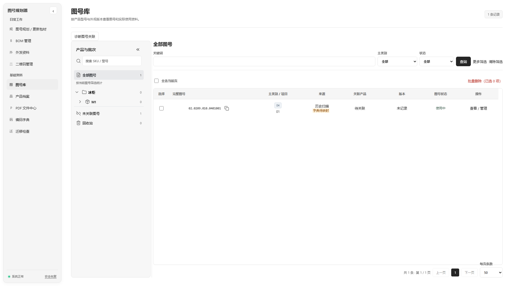
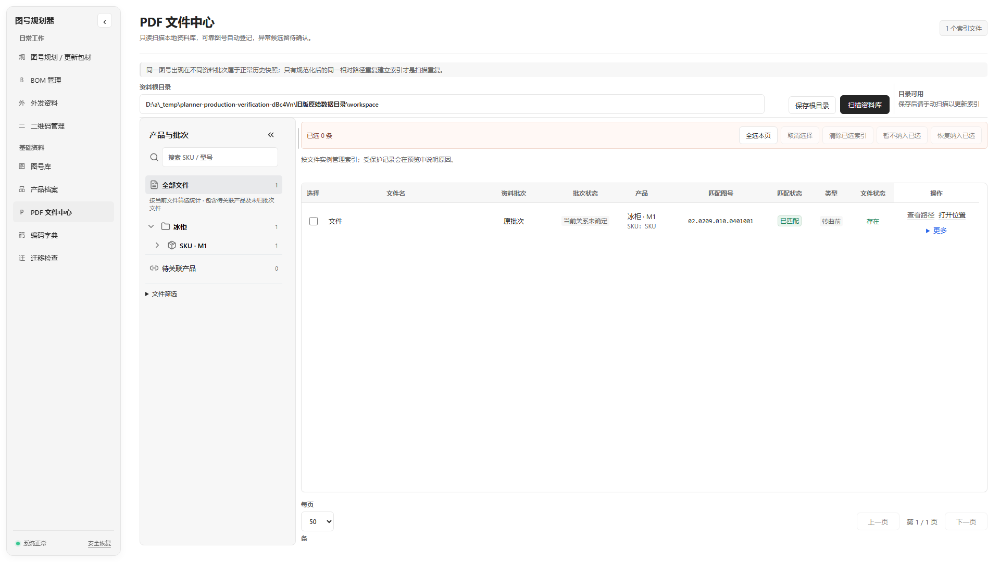
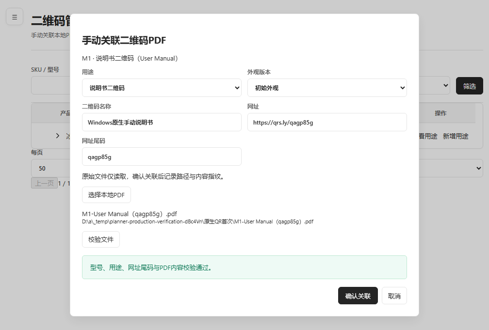

# 综合改版交付记录（2026-10-21）

本轮包含用户确认的综合改版、图号规划原子归属与独立沿用，以及上传的外发 V2.0。原第二轮30项看板仅为历史范围，不能代替本轮验收。

## 已实现的主要行为

- 产品主档案保留同一 SKU/型号，多外观版本、颜色配置、明确启用和历史版本；版本 BOM 独立，复制和实际差异预览。
- 产品归并保留原 raw 身份、外键、图号、二维码、PDF、BOM 与外发快照；展开完整别名组盘点，不在启动时自动执行。
- 正式批量占号同时保存真实产品/外观关联；独立沿用关系不改原占号或归属、不自动入 BOM。
- 图号诊断、人工/批量确认与审计；扫描目录信息只作候选，不冒充确认事实。
- PDF 纯扫描索引安全清除、被引用索引保留、暂不纳入与恢复、持久内容变更复核、批次显示名编辑。
- 二维码产品主表/五列用途行；原生选择本地 PDF、型号/用途/网址尾码校验、实际PDF与硬扩展名验证、受控名称例外、替换/解除和不可变审计；业务状态独立。
- 外发以明确批次为文件来源，BOM 仅辅助；真实内容哈希对比、基准/异常/额外资料明确确认；生成前服务预检、ZIP分包真实清单/大小/哈希校验、不可变历史与安全再生成。
- 缓存、最新请求守卫、记忆10/25/50/100分页、统一导航/表格；后台任务完成后刷新受影响查询。
- v15/v16→v17事务升级、WAL一致备份、稳定数据目录；首次启动明确选择原数据或空库，不以新SHA静默创建替代空库。

## 测试和构建结果

- 应用提交：`34bf3360f25a019f0124acf9fbd398993e6f7bba`；开发分支 `codex/comprehensive-appearance-20261020` 已推送，未合并master。
- 完整套件：152文件、1270项全部通过；最终日志 `work/final-delivery-suite.log`，2026-10-21 16:35:43 UTC开始、249.38秒。TypeScript、Vite与Main构建通过；最终弹窗调整另有4文件16项回归通过。
- [Windows Actions 39636465335](https://github.com/Yaeeeeeeeeeeeee/drawing-number-planner/actions/runs/39636465335) 全部成功：实际中文安装向导和可编辑路径、中文路径安装、158文件逐个哈希核验、旧v15→v17升级、原settings字节与历史行/快照保持、迁移前可读备份、WAL提交页、故障事务回滚和重启。
- 实际Windows原生QR文件选择→校验→关联→重启→更换→解除→再重启全部通过；旧QR与BOM/PDF/外发记录保持，原始文件哈希不变。弹窗真实fixed遮罩和完整边界通过。
- 六模块×五种真实renderer viewport：3840×2160、2560×1440、1920×1080、1366×768、720×600，30PNG尺寸逐一核验。runner物理screen为1024×768、DPR1，不能据此宣称物理4K/DPI/跨屏验收。
- 原始报告见 [verification目录](verification/comprehensive-20261021/delivery.json) 及同目录的完整Windows JSON。隔离旧库夹具和真实临时PDF用于自动化；未取得或操作用户本地正式业务库。交付新建库不含这些夹具。

## 安装包与提交记录

安装ZIP为 `Comprehensive-Windows-Chinese-Setup-34bf3360f25a019f0124acf9fbd398993e6f7bba`，artifact `12362011165`，144,555,309字节，内含 `图号规划器-Windows-x64-安装包.exe`。

ZIP SHA256：`760eac2658e7a0abd6d942b2b546e9b5182c36aa3ef6bc1ee0ccfe36969cccea`。这是GitHub产物ZIP校验值；实际安装后的158程序文件另逐一比对。产物保留至2026-11-04，主下载使用临时直链，过期时需重新生成。

[应用提交](https://github.com/Yaeeeeeeeeeeeee/drawing-number-planner/commit/34bf3360f25a019f0124acf9fbd398993e6f7bba)；[本轮全部提交](https://github.com/Yaeeeeeeeeeeeee/drawing-number-planner/commits/codex/comprehensive-appearance-20261020)。主要实现为b59a949，后续提交完善原生验收和QR视觉；安装包严格固定上述应用SHA，文档归档提交不重新生成应用。

## 实际Windows截图及视觉核对

同一1920×1080窗口、同一旧Schema测试库，图号/PDF使用共享目录树、Lucide图标、标题行收起图标、行高/缩进和浅灰选中。图号树按型号/外观，PDF树保留SKU/型号及实际批次，分别按图号主记录与PDF索引统计；未确认的历史图号不能因PDF已有产品目录归属而冒充确认。

| 图号库 | PDF文件中心 |
|---|---|
|  |  |

其余产品、QR、BOM、外发、安装向导与替换/重启截图保存在同一目录；全部30个尺寸截图另保存在验证artifact `12363175092`。

## 本地安装、替换与首次升级

1. 完全关闭旧版程序，保留旧安装目录和数据目录。不要先卸载或删除旧库。
2. 使用中文安装向导选择新安装路径；程序目录与业务数据分开。
3. 首次启动，升级用户选择“选择旧版数据库”，定位到原业务数据目录的 `planner.db`。旧验收版通常位于 `%APPDATA%\DrawingNumberPlannerAcceptance\<旧版本前7位>\planner.db`；首次选择窗口直接打开 `%APPDATA%`。请选实际维护过数据的那个目录，不凭日期自动猜选。原目录的 `settings.json` 和原始PDF路径继续使用。新用户才选择“创建空数据库”。
4. 程序在原数据目录 `backups` 中先生成可独立读取的SQLite迁移备份，再执行事务升级；失败时不清空数据库、不自动重新归类历史。
5. 重启继续使用 `%APPDATA%\DrawingNumberPlanner\profile.json` 指定的同一数据目录。数据库丢失时明确报错，不静默创建空库。
6. 核对产品、图号占号、历史BOM、二维码、PDF索引、资料批次和外发历史。原始PDF不移动、不重命名、不删除。

## 回滚

关闭新程序，另存升级后数据库以便诊断；使用迁移前备份恢复原业务目录的 `planner.db`，保留旧 `settings.json` 和原始PDF。不得用旧版程序直接打开已升级v17库。若有WAL/SHM文件或不能确定数据库是否关闭，先保留整个数据目录副本再处理；不要随意删除日志文件。

## 仍由用户在本地明确执行

- ZC100/WB55真实归并：在产品档案选择规范主档与来源，预览引用/QR冲突后确认。归并保留主档当前外观；随后编辑规范主档→外观换代→WB55历史版本“预览并启用”→确认启用，使其成为当前版本。启动不会自动进行这两步。
- 历史不明确的产品/外观关联、批次归属/完整性及对比基准，需要核对依据后人工确认。
- 物理Windows中文输入法、实际4K系统DPI/跨屏与用户真实业务数据的最终核验。自动化窗口截图不代替这些本地条件。

## 安全审查

已修复并专项验证：WAL checkpoint繁忙导致复制库缺已提交数据；归并成员引用漏检；纯扫描派生归属冒充确认；QR名称例外绕过PDF扩展名及新建预检上下文过期；外发历史来源伪造及范围变化后的旧异步结果回写。上述安全问题已复审，最终Windows原生交付验证通过；用户本地真实数据核验和物理DPI条件仍由用户验收。
