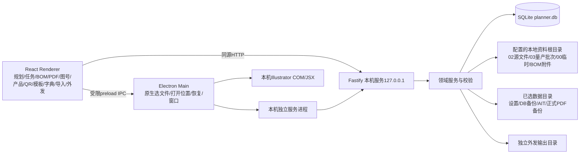

# 图号规划器：项目基线审计候选

审计日期：2026-11-05（Asia/Shanghai）。状态：**只读审计形成的候选，等待用户确认；不是新需求批准或开发授权。**

## 1. 审计对象、边界与阅读方法

- 仓库：`Yaeeeeeeeeeeeee/drawing-number-planner`；本地分支 `codex/v3-business-ui-20261022`。
- 审计起点 HEAD：`45450c00e8a5acf9089adf47bcee0ecc3c71c616`，起点 `git status --porcelain=v1` 为空。
- 应用版本1.5.0；发行源码 Tag `v1.5.0` 指向 `096dabc1561164e7f3eed91c7800f52006cc7904`；HEAD比Tag新增的是发布/文档/截图，不是另一套应用实现。
- 静态清单：966个受控文件，278个 `src/` 文件，62个脚本，242个测试/夹具文件；其中218个单元/集成测试文件、13个E2E规格。346个docs文件由159个MD/TXT/JSON和187张PNG组成。数字是审计起点统计，不含本轮五份新文档。
- 已检查需求/设计/计划/交付文档、现有源码入口与关键业务链路、全部迁移层、测试规格、版本记录、截图目录；附录给出全部源码覆盖清单。**不等于穷尽所有运行分支或重新证明每项实现正确。**
- 本轮不启动应用，不打开业务数据库，不运行迁移/自动化测试/扫描/备份/恢复，不生成安装包，不提交/推送，不修改现有业务文件。五份审计文档是唯一新增交付；历史进度看板不改写，以保留原始证据。
- 用户本地正式数据库、真实AIT/授权Illustrator、物理显示器DPI及中文IME未取得，本轮不能对这些环境作通过结论。

配套文档：

| 文件 | 用途 |
|---|---|
| [REQUIREMENT_STATUS.md](REQUIREMENT_STATUS.md) | 来源等级、逐项确认/否决/实现状态、冲突替代链和全部文档索引 |
| [UI_DESIGN_CATALOG.md](UI_DESIGN_CATALOG.md) | 所有生产页面、弹窗、共享交互、v15专项、187张历史图片索引 |
| [IMPLEMENTATION_GAP.md](IMPLEMENTATION_GAP.md) | 已核实差异、静态风险、证据缺口；不附自动实施决定 |
| [OPEN_QUESTIONS.md](OPEN_QUESTIONS.md) | 未确定的业务范围、资料缺失、验收与后续决策 |

### 1.1 来源纪律

1. 本次用户“仅审计”指令覆盖此前持续开发/打包授权，不因此继续开发。
2. 用户最后明确要求优先于早期要求；只有明确后续修改才记为替代。不能确定的冲突保留双方来源，不自行裁决。
3. 需求归档正文是业务要求证据；Git作者、文件名含approved、AI计划勾选、测试通过、Skill写Current、交付报告称完成，均不能单独证明用户认可。
4. 当前对话保有部分用户原文（V4.1/V4.2、手动QR、V5.2及空文件夹答复等）；未有独立原稿的地方在来源表明示。不能把AI整理的V5.2摘要扩大到原文未涉及的页面。
5. “实现”与“用户确认”分两轴；“代码存在”“生产可达”“测试定义”“过去运行记录”“本轮运行”也分开。
6. 本文列当前可追溯规则和代码事实；后续是否采纳待确认内容，以用户对本次审计的确认及原始证据为准。

## 2. 架构与运行方式

- 技术栈：TypeScript、React19、Fastify5、better-sqlite3、Electron、Zod、Lucide、archiver、read-excel-file；Vite/TypeScript构建，Vitest/Testing Library/Playwright验证。依赖范围见 `package.json:1`，确切安装解析看 `pnpm-lock.yaml`。
- `src/main/index.ts` 管桌面窗口、服务生命周期和IPC；`src/service/entry.ts` 为服务进程入口；`src/server/start-server.ts` 组装同一领域服务；`src/server/routes/`17组路由。
- `src/core/` 按planning/drawings/files/bom/products/qr/outbound/import/packaging/tasks/config分域；`src/db/`存连接、Schema、迁移、DB快照备份。
- Renderer没有浏览器路由系统，主导航由 `AppShell.tsx:33` 的页面状态切换。已访问的若干页面保留挂载；不是所有页面都保留。规划、任务、模板、产品、图号、QR、PDF存在active/访问状态逻辑；BOM/字典/迁移的生命周期另见各组件。
- Web预览和桌面共享业务API/页面，但原生QR选文件、输出目录、文件所在位置、Illustrator和进程恢复依赖桌面桥。不能把浏览器成功解释为Windows原生操作成功。
- 服务绑定回环地址；写请求要求允许的Origin及每次服务启动的token，session接口也校验Origin。Electron启用sandbox/contextIsolation、关闭Node集成并限制导航/弹窗。手动QR IPC另校验准确sender/frame；部分旧文件/输出/恢复handler没有各自sender检查，不能概括所有IPC已同等认证，本轮未证明可利用攻击。见 `src/server/security/local-access.ts:7`、`src/main/index.ts:41`。

## 3. 名词与业务不变量

| 名词 | 当前含义与边界 |
|---|---|
| 产品 | `products.id`为真实身份；SKU、型号、同品牌型号均可重复；不得凭文字自动归并 |
| 品类尺寸 | 编码字典中的四位维度，与页面“产品类别”业务文字不同；不可把productSizeId当产品类别筛选值 |
| 外观码 | 第三段前两位；可在同一产品上使用多个外观码；默认外观仅规划默认，不是所有历史记录归属边界 |
| 颜色码 | 第三段最后一位；颜色名称从字典解析，不能猜PDF文件名 |
| 独立外观版本 | Schema16/17遗留对象；V3/V4已撤销日常管理UI。保留底层引用不等于重新批准该UI |
| 正式规划图号 | 内部planned身份；对外完整码唯一；占号时写入产品/外观绑定，初始reserved，不自动进BOM |
| 历史扫描图号 | 独立historical身份；可靠完整码进入占号集合；旧扫描product_id可只是候选 |
| 图号身份 | origin+recordId；统一列表常用planned正ID/historical负ID。完整码文本不能替代历史身份代次 |
| 业务状态 | 用户界面使用中/已停用；底层reserved/active/voided或active/inactive仍有语义区别；停用不释放号码 |
| PDF实例 | 一条实际路径/索引/内容事实；产品归属、图号匹配、转曲角色、磁盘存在、纳入状态彼此独立 |
| 资料批次 | 实际03子目录与内部批次ID；显示名不是目录名，同名不能合并；当前/历史不由mtime决定 |
| BOM记录 | 实际业务提交和当前关系；内部版本/前驱及快照保留，不把V1/V2做用户版本体系 |
| 制图任务 | 实际产品ID下一个未完成任务；不是按型号字符串全局唯一；新建/修改正式文件两类 |
| 暂不纳入 | 针对文件实例的业务候选排除；不删原件/历史占号/既有引用；内容变化需复核 |
| 删除/释放 | 多种不同操作，不能用同一个“删除”概念概括，见第8节 |

图号格式由 `src/core/drawings/drawing-code.ts:21` 解析：`BB.SSSS.AAC.MMJJNNN`，各段长度2/4/3/7；AA外观、C颜色、MM主类、JJ项目、NNN001–999。编码字典、父项目关系、活动状态须校验；流水号按完整前缀而非仅产品计算。现行需求出处：V3§二、V4§一/二；早期Excel公式来源记录见 `docs/DEVELOPMENT_PAUSE_AND_CONFIRMED_REQUIREMENTS.md:52`。本轮没有读取用户真实Excel字典或正式库值。

## 4. 全部模块基线

### 4.1 图号规划 / 更新包材

**职责**：选产品与原编码维度，任意组合字典项目，预览、查重并事务占号；不是制作参数编辑器。

**现有流程**：产品类别→真实产品ID→默认或手选外观；每行主类别→项目、颜色、备注；增删行。行下实时预览250ms防抖且拒绝旧响应；“生成文件→查重并预览→确认批量占号”。未获实际保存图号不能生成任务；改输入会使旧查重确认/结果失效。成功卡片按返回ID显示图号及品牌/型号/颜色/项目，复制，精确定位图号库；无关刷新/切页保留结果。

**业务保护**：正式/历史/保留删除占号统一查重；每批1–100行；事务内重新预览并比较expectedFullCode，遇并发冲突整体回滚；绑定产品和实际外观；不自动创建BOM。显式释放的号码才可重用。

**关联**：products/dictionary→drawing_numbers→drawing_appearance_bindings；保存ID传制图任务/图号库。没有AIT尺寸或模板请求。

**依据**：`PlanningPage.tsx:42,85,116,135,158,168`；`planning-service.ts:21,59`；`planning-repository.ts:92`（路径前缀均为对应renderer/pages或core/planning）。测试 `tests/core/planning-service.test.ts`、`tests/renderer/planning-page.test.tsx`。

**差异/待核**：同前缀多行实时预览各自用单行请求，会暂时显示相同预计码，完整批量预览仍正确（G-04）；初次加载/错误可访问性不完全统一（G-05）。是否要求行预览在批量查重前就唯一，见Q-05。

### 4.2 制图任务

**职责**：从已占号身份制作文件、匹配AIT、监听人工文件、检查、统一归档、继续与删除记录。入口独立位于日常工作规划之后；不是第二套任务服务。

**创建/详情**：从规划带入实际产品/图号，无需重选；日常可手选有效占号图号。系统命名，可靠目录唯一时自动使用，多候选/不可用才要求选目录；新建与修改正式文件保留必要区分。同一产品实际ID在DB中仅一条非完成且未删除任务。已有任务展示状态/继续；标题品牌·型号，不展示UUID；七字段紧凑项目行、按需展开设置；人工模式隐藏尺寸；AIT按本次尺寸匹配，冲突不自动选；无需生成可跳过。草稿不被常规轮询覆盖，未保存设置阻止批量生成/归档。

**文件关系**：新任务直接使用产品`00.临时文件`，重名排他编号；旧任务继续保存的嵌套路径，不自动搬迁。修改正式PDF先复制，先持久化copy_destination_path再写副本；别的保留任务文件/未提交副本不能被自动认领。人工文件按完整码优先识别，不唯一需明确关联。当前PDF按SHA256确认，变化使确认失效；旧嵌套任务的人工整理有复制后移除原临时输入的历史行为，不可泛称所有输入始终原位不动。

**归档/恢复**：预检整批、全部准备后统一确认；新文件排他发布到02；修改校验正式原件、保留核验备份后安全替换。journal prepared→published→indexed；仅产品范围扫描核实后清理本次实际归档且未变化的受管临时文件。00、旧目录、其他/变更文件保留。多文件磁盘发布顺序执行，不是跨文件全有或全无回滚；失败由持久日志/备份/临时文件续作。中断generating启动后转failed，需核对/重试，不能声称自动接续Adobe会话。

**删除**：预览任务/文件/journal指纹；生成中或部分归档/待索引阻止；未完成需确认后果。事务仅留痕删除并解除产品任务锁，保留DB行、物理文件、索引、占号、BOM、外发。无日常恢复已删除任务入口；后续任务不自动使用遗留文件。

**依据**：`src/renderer/pages/DrawingTasksPage.tsx`、`packaging/PackagingTaskPanel.tsx`；`src/core/packaging/packaging-task-service.ts:73,111,122,135,188,236`、`packaging-archive.ts:27,65,99`；`schema-v24-packaging.ts`、`schema-v25-task-ui.ts`。测试 `packaging-task-service.test.ts`、`drawing-tasks-page.test.tsx`、`ait-packaging.spec.ts`。

**差异/待核**：任务历史回页不自动重载（G-02）；删除指纹失效后弹窗反复用旧token，须取消重开（G-03）；空表反馈不足（G-05）。真实Adobe未验（E-01）。

### 4.3 PDF文件中心

**职责**：只读正式资料扫描、实例索引、产品/批次导航、人工归纳、排除/恢复/安全移除。当前本地路径不切服务器。

**UI**：类别→产品→源文件/资料批次，孤立批次/待关联入口在同一滚动区。批次左键选择、右键重命名/删除（含菜单关闭/边缘定位）；无常驻铅笔。列表快捷全部/源/转曲后/缺失，详细关键词/匹配/类型/存在/纳入/批次/修改日期。六个图标分左右各三组；全选只已加载行。无常驻右详情抽屉；逐行路径/打开操作。虚拟渐进加载，正常无10/25/50/100传统分页UI。

**扫描**：只产品直接子目录`02.未转曲源文件`、`03.量产后的变更文件（已量产的产品看最新日期）`，03遍历全部历史批次；00/根部QR PDF不进正式扫描。02按源文件，03按文件名全角（转曲）标识；不解析PDF内容来判转曲。完整覆盖/稳定指纹/安全路径后一次提交；不可访问、写入变化、相关链接或不完整遍历导致失败，旧索引不批量标缺失。范围外旧索引/历史保留，未观察不等于删除。指定产品扫描不改其他产品或QR索引。

**人工归纳**：具体PDF IDs预览、理由、指纹、确认、备份后事务写产品/批次关联和归属审计；图号归属冲突可明确选择仅改PDF，不重写图号绑定。**排除/恢复/移除**：另一路径事务重查/确认，写管理决定或清索引，没有人工归纳同等的理由/备份/归属审计步骤。忽略/恢复按workspace/path/hash决定持续；同路径内容变化变待复核。移除索引不删原PDF、不释放占号，受保护引用照常拦截。

**批次**：raw路径/识别名/显示名/业务日期/目录顺序独立；改名仅显示名。当前批次用可靠序号或日期全序，歧义不强选，mtime无权决定；首批大货可识别。删除仅经真实空目录和引用校验的内部记录/合格失效索引，不删磁盘目录，不因无法访问认定空，不自动重排其他业务顺序。

**依据**：`FilesPage.tsx:195,282,289,384,401,436,438,521`；`src/core/files/{pdf-scanner,file-service,file-repository,pdf-management,pdf-classification,material-batch-service}.ts`；相关同名core/server/renderer测试。

**差异/待核**：自动监听仅覆盖已有00或未完成任务产品（G-01）；类别选择扫描范围含糊（G-06）；背景错误无UI状态（G-07）；元数据失败可能变空（G-05）；加载超过500全选与服务限额不衔接（G-08）。存在筛选/计数用扫描索引状态，逐行可用性/详情会读当前磁盘，二者不是同一时点（G-09）。

### 4.4 图号库

**职责**：正式与历史图号统一检索、占号/状态、真实产品归属、诊断/纠错及PDF/BOM关联。

**UI**：类别→型号→实际编码主类别；特殊全部/待关联/回收站。完整图号、主类标签/项目单行、来源、关联产品（型号，不重复SKU）、颜色、状态、操作；颜色由分离的AA/C及字典解释，无记录“未识别”。不同主类稳定浅色标签；使用中/已停用标签。更多筛选、虚拟渐进加载、多选批量删除；布局记忆与恢复。详情基础信息双列、文件信息、BOM关联、状态操作四组；源文件仅02、转曲后全部有效批次按业务日期，当前/历史标签，不任意选最新文件；无批次选择器/独立外观管理。

**归属**：现有明确绑定优先；PDF人工归属/BOM/已完成外发等提供独立证据。旧扫描product_id、目录及前缀不是自动已确认事实；后续用户明确授权的一键归类可对唯一候选执行，需实际操作、备份/事务/审计；歧义不强选，纠错有理由。不是启动自动归并。批量占号已原子写归属。保留legacy沿用服务与历史，不恢复独立外观沿用UI。

**状态/删除**：使用中⇄已停用，reserved仅占号未使用；停用不释放。普通删除保占号与普通释放资格分开。普通释放阻止历史真实使用/受保护引用，仅可证明误占且未使用者经准确图号确认释放；两种状态都能进入检查。V5独立强制释放是后续例外：影响预览、指纹/确认、保留旧身份/快照/审计、隔离旧同号PDF并释放当前占用，不删除原件；旧同号文件不自动成为新代身份。

**关联**：首次BOM按实际首次创建纳入记录，精确ID跳转，删除/不可访问有明确提示，不找相似替身；业务日期更正不重新定义首次。

**依据**：`DrawingLibraryPage.tsx:352,414,423,475,519`；`src/core/drawings/{drawing-query-service,drawing-association-service,drawing-deletion-service,drawing-force-release-service,drawing-product-evidence}.ts`；`src/core/files/drawing-file-observation.ts`。测试 `drawing-v41-page`、`v3-drawing-product-association`、`v5-force-release`、`drawing-file-observation`。

### 4.5 BOM管理

**职责**：记录产品实际用图号、独立业务字段、当前关系和可追溯的历史更正；不强制先有BOM才外发。

**录入**：类别→型号→业务变更日期；统一录入，无当前/历史类型下拉。每项目独立主类/项目/图号/白色沿用/生效批次/材质/尺寸/位置/图片/位置示意/修改明细/备注，QR字段不再展示但关系保留。新增保存清临时行/图片/示意图/待提交状态，保留成功提示与当前并发基准。

**编辑/查询**：精确记录ID、edit_revision及current指针校验；修改日期获V5.2后续明确授权，仍保留ID/createdAt/前驱/其他记录/不可变快照。查询仅型号、主类、项目三个下拉+时间范围/图号。表格业务日期/提交时间/型号/项目/修改时间、查看/编辑/删除；整产品删除独立危险区。详情选中左/明确前驱右，默认变化字段，可切全字段/折叠；首次单侧，不造差异数。失效前驱提示，不猜按日期。

**附件**：素材与位置示意分角色；明确沿用上一条实际前驱同项目有效附件；本次上传不受前驱来源限制。上传/归档排他写、哈希核验、旧源保留；目录在资料根`BOM附件/型号/业务日期/...`，旧路径兼容。相同有效SHA256视内容相同，不因文件名/ID变化报变化；缺hash/重复角色待核，视觉相同但二进制不同尚无已验证感知比较。

**删除/历史**：删一条与整产品分开；当前记录删除回退有效前驱或清current；编辑不新增相似记录，不重新引入同图号不可重复记录限制。更正快照、外发快照不随编辑覆盖。

**依据**：`BomPage.tsx:69,98,161,168,179,200`；`bom/BomQuery.tsx:31`、`BomEditor.tsx:45`、`BomHistoryComparison.tsx:35,57`、`bom-history-diff.ts:24`；`src/core/bom/bom-service.ts:169,222,279,316`、`bom-asset-service.ts:37`。测试 `bom-service`、`bom-concurrency`、`bom-asset-archive`、`bom-page`、`bom-history-diff`。

### 4.6 产品档案与基础身份

**职责**：维护实际产品ID、SKU/型号/品牌/类别/编码默认、参考来源、启停、历史产品候选和集中退出。

**UI**：当前生产主表9列：SKU、型号、品牌、产品类别、状态、说明书、售后卡、菜谱、操作；全部显式居中，无外观行内展开、无独立外观版本管理。列表仅编辑，编辑页再启停/退出。过滤SKU/型号、品牌/类别/状态，virtual渐进显示；产品→QR用途跳转保筛选/滚动并返回刷新。新增不自动创建初始外观对象或QR。

**编辑/历史**：已被图号使用时锁定影响编码语义的字段，默认外观仍可改且不影响其他旧外观引用。字典回页/开编辑刷新，失败禁止保存。历史候选按准确目录和歧义预检，确认先备份/事务并写人工归属，不只是临时展示。

**集中退出**：两组不预选：保留/释放占号、保留/永久清业务历史；单次输入型号、折叠图号清单、最后确认，提交实际预检所有图号与指纹。共享/其他产品引用、V2冻结范围、手工QR历史等可能阻止退出/永久清历史；不是任何产品都可任意退出。退出后无业务恢复入口；停用再启用不等于恢复已删除档案。

**遗留兼容**：canonical identity映射、版本/归并API仍注册；旧面板没有生产挂载。不得据存在API重启ZC100自动归并；是否继续保留/开放接口是待确认范围。

**依据**：`ProductsPage.tsx:59,105,130,212,235,270`；`ProductCleanupPanel.tsx:12,29,46`；`src/core/products/{product-service,product-cleanup-service,product-cleanup-options,appearance-service,appearance-identity}.ts`。测试 `products-page`、`products-dictionaries`、`product-cleanup-options`、`product-cleanup`。

### 4.7 二维码管理

**职责**：实际产品→用途记录，手动关联本地PDF；业务启停与文件状态独立，不参与正式占号。

**UI**：当前主表7列SKU/型号/类别/说明书/售后卡/菜谱/操作，V3已覆盖早期“产品/数量/关联比例”的主表设计；SKU/型号按V5.2居中。用途展开仍是五列：用途、关联文件、网址、业务状态、操作，只有关联文件左对齐。未建用途仅展示虚拟行，不计实际QR记录。文件显示简名，原始名/路径tooltip；真实URL可开/复制，不从文件名拼URL。当前没有待人工确认/自动候选匹配区。

**手动流程**：原生PDF窗口可从索引外本地选择；显示产品/用途/名称/实际URL/尾码，校验PDF头、型号、英文用途、末个有效URL路径7位标识；兼容中英括号、合理空格/用途大小写。命名例外要勾选+理由审计。受控选文件token，不能由Renderer任意传路径注册。确认事务重查元数据/文件指纹，追加不可变文件事实、关闭旧link、建立当前link，不改变原QR名称/URL/状态。失败保留输入，取消不保存；新建QR当前默认inactive。

**详情/历史**：名称与URL编辑、启停、关联/更换/重关联、解除、删除；旧关联/扫描文件折叠留痕。解除不删文件、不停用QR；有任何历史link/BOM/旧索引可能阻止删除，不能承诺解除后一定可删。手动注册文件用绝对路径，迁盘需重新关联；不受02/03扫描目录限制。没有QR删除恢复UI。

**依据**：`QrCodesPage.tsx:18,39,62,78,91,107`；`src/core/qr/qr-manual-{service,validation}.ts`、`qr-repository.ts:130,170`；`src/main/qr-manual-actions.ts`；`src/db/schema.sql.ts:1211`。测试 `qr-manual-service`、`qr-manual-validation`、`qr-codes-page`、原生验收脚本。

### 4.8 编码字典与迁移检查

**字典**：品牌、品类尺寸、外观、颜色、主类别5个一级页签，项目在主类子工作区；搜索编码/名称、状态/显示已删除、名称内联编辑、启停、普通删除、恢复、已删除项永久删除资格检查+准确编码确认。编码/ID不因改名改变。普通无引用可物理删、有引用留痕；永久删检查所有实际FK/编码快照/父子关系，包括CASCADE/SET NULL。当前搜索只查父/根items，不过滤子项目；前端禁止停用父新增，服务仅校验父类型/存在，限制不完全一致（Q-11）。

**字典Excel**：迁移检查不是全库业务关系审计；读取指定sheet和固定列，先只读报告→异常/候选视图、搜索/范围/结果过滤→选择→备份后事务导入。全选可包含过滤外可导入候选，有明确计数。冲突禁选，失败保选择，成功消费报告。界面accept xls/xlsx，但真正旧二进制xls提示另存xlsx，不宣称原生支持。服务报告内存过期，不是永久导入作业。

**邮件Excel**：同一迁移入口单独模态；按首批/更新sheet的供应商及场景/案例单元格解析。厂家、收/抄、主题、正文、签名分开；配件/ITR明确不导入；原始案例/单元格坐标保留，不把旧PO/日期/型号/铭牌原因变通用默认。逐条新增/更新/跳过、联系人复用/新增/跳过和角色独立确认、签名单独处理；重复导入查指纹，不能静默覆盖手改。失败/成功反馈在底部按钮旁。原始工作簿及私人联系内容不重复写入本基线。

**依据**：`DictionariesPage.tsx:12,31,73,144`、`DictionaryPermanentDelete.tsx`、`ImportPage.tsx:38`、`EmailTemplateImport.tsx:20`；`src/core/import/{excel-audit,excel-import,email-template-matrix,email-template-import}.ts`；`src/server/routes/{import,email-template-import}.ts`。

### 4.9 包材模板管理

**职责**：AIT原件、完整图号映射、适用产品/品牌、模板尺寸规则和项目制作方式；不创建日常任务、不维护模板版本体系。

**UI/功能**：当前采用AIT模板管理/模板匹配规则/项目生成设置三页签；搜索/项目/状态、上传/替换/编辑/本机检查。AIT对象可自动读取及手动输入；填入内容中文完整图号；必填与自动字体/手工字体。配置只让用户选AIT/人工/无需生成，以及无需/二维/三维尺寸匹配，底层旧参数键与规则绑定保留。规则中文长宽高比较/区间、固定模板、仅长宽互换；多候选明确手选，不把匹配尺寸用于缩放设计。复杂尺寸档案表单已撤出日常主流程，旧规格底层及任务兼容入口保留。

**生成边界**：生成时服务、适配器、JSX三层只允许DRAWING_NO写入；原品牌/型号/颜色/画板/刀模/排版不重写。模板副本+PowerShell STA/COM/JSX+preserveEditability PDF导出，不独立AI；不关闭用户已有文档。没有真实AIT/Adobe的新验收，不能仅凭VM/上传合约确认全部版式/字体/可编辑性。

**数据**：模板/尺寸/规则/项目配置复用同一products/dictionary；适用品牌/产品的部分ID列表在JSON内，非FK；上传AIT位于数据目录的不可变资产路径。替换不直接重写旧任务模板快照。

**依据**：`PackagingTemplatesPage.tsx:22,39,43`；`packaging/PackagingEditors.tsx:31,50,63,72`；`src/core/packaging/{packaging-catalog,packaging-matcher,illustrator-automation,illustrator-jsx}.ts`；`src/server/routes/packaging-template-inspection.ts`。

### 4.10 外发资料与邮件

**职责**：选真实批次及文件范围、核实文件/变更、ZIP分包、本次结果、可编辑邮件，不负责自动发邮件。

**UI**：同一工作台4步：品牌→产品类别→产品型号→批次及首批/更新、仅变更/当前完整两独立维度；预览可用文件/来源/状态，选中核查→生成前预检→输出目录→本次分包结果→邮件。邮件配置互斥三标签：模板、签名、联系人；有脏编辑/保存中离开保护。日常额外资料/历史ZIP区明确按V5撤出；旧组件/API/快照继续保留，不能当成漏入口。

**业务**：以选定批次为主，不要求BOM先存在、不自动从旧批次补齐完整包；BOM只辅助项目/变更。可靠前批按相同编码范围和明确顺序/日期，不看mtime；基准歧义/同号不同内容等需哈希绑定确认。默认转曲PDF；当前缺失/无法读/索引陈旧分开。预览有可能补写NULL内容hash，不能称所有预览绝对DB只读。

**ZIP**：真实内容核验、服务器预览指纹和生成前复查、排他输出，不覆盖旧ZIP。以完整PDF为单位分包，目标49,000,000、硬上限实际ZIP50,000,000字节；压缩后仍超限的单文件阻止并提示独立传输，不切PDF、不改原PDF。早期S03对原始单文件>50MB有阻止示例，V5又要求大PDF可入外发清单；原始大小和最终ZIP大小的最终政策边界仍见Q-30，不能只凭现代码裁决。冻结产品/批次/文件/分包快照。失败仅清自己的临时/已发布输出，不能删无关ZIP；原始包材不改。Web缺桥不能真正生成ZIP。

**邮件**：成功ZIP返回mailFacts才可生成；厂家/类型/场景按实际配置选择，不能乱用历史“铭牌”原因。只列实际打包且有可靠变化或人工确认的新/变更项，BOM理由可复用、未知由人填。签名一次；手改正文不被异步/条件自动覆盖，替换需明确确认。共享联系人保留原公司/默认角色，模板显式收抄送关系和明确零联系人优先。复制正文/主题/收抄送/完整邮件；不发邮件。当前草稿在React状态保留，存在历史draft表不等于本页已自动持久保存。

**依据**：`OutboundPage.tsx:18`、`outbound/{PackageBuilder,PackageResult,EmailComposer,MailConfiguration,TemplateSettings,ContactsManager}.tsx`；`src/core/outbound/{outbound-batch-workflow,outbound-package-service,outbound-reference-service}.ts`；`tests/core/outbound-package-service.test.ts`及邮件相关测试。

**差异/待核**：遗留产品target分支中categoryId有两种不一致赋值，但当前未找到日常入口；仅静态兼容风险见G-10；外发型号option是否必须只品牌·型号不能从V5.2产品档案专属要求扩大（Q-10）。视觉等价图片比较与邮件草稿重启持久化见Q-12/Q-13。

### 4.11 软件设置、安装、备份与恢复

**设置不是独立总页**：PDF详细信息内设本地资料根；ZIP生成原生选择输出目录并保存；用户选数据目录由安装标识/profile控制；窗口布局和列宽顺序在本机状态/LocalStorage。不存在服务器切换/多根独立目录库。

**安装选择**：每次成功安装有新marker，首次启动旧/新库二选，普通重启沿用。新库自动独立data或data-*，不用选文件；旧库选择planner.db，只读格式/quick_check，原profile临时文件+原子rename。安装/数据/资料目录独立；选桌面根规范到专用子目录，桌面子目录原样保留；不携带业务样本，不卸载用户库/材料。

**备份**：DB一致快照VACUUM INTO，排他文件名+只读完整性核验；迁移前先做；旧库启动每天一次有效daily，留30个有效daily，不计/不删其他备份或损坏证据，失败记录但不必阻止正常业务启动。**不是运行中每天定时，也不是全资料备份**。AIT/设置/正式PDF备份、外部QR/BOM图片/ZIP不在DB快照中；完整备份目前按关闭程序后人工复制数据目录，并分别保留原材料/外发路径。

**恢复**：当前安全恢复仅结束任务、重载界面、重启服务、重启程序；不是DB还原/重新选库界面。普通任务注册在内存，制图任务另有持久表/journal；直接服务重启与整应用重启的等待/取消边界不同，不能泛称所有进行中的工作自动无损完成。完整DB恢复是人工独立目录还原备份配设置/附件；旧程序拒绝新Schema，不可只降版本程序。

**依据**：`src/db/{backup,migrations}.ts`、`src/core/backup/daily-backup.ts`；`scripts/{production-profile,production-entry}.cjs`、`comprehensive-windows-installer.iss`；`src/main/{recovery-controller,local-service-controller,index,preload}.ts/cts`；`SafeRecovery.tsx`、`src/core/files/workspace-settings.ts`。

**差异/待核**：安装说明声称安全恢复可重新选库，但入口不存在（G-11）；profile先提交后迁移，后续失败并不总保留旧profile（G-12）；进程恢复不是备份还原（Q-07）；根目录切换不是独立多资料库（Q-08）。

## 5. 数据模型与迁移基线

### 5.1 关联总览

| 领域 | 当前持久结构 | 重要关系/限制 |
|---|---|---|
| 字典与产品 | dictionary_items, products | 字典自父子；产品brand/size/defaultAppearance与referenceProduct；v19后无SKU或品牌型号唯一约束 |
| 产品兼容身份 | product_identity_state/members, product_appearance_versions/colors, product_merge_events | raw→canonical不重写原外键；旧版本/current/颜色/归并快照保留；日常无独立版本UI |
| 图号 | drawing_numbers, historical_drawing_numbers, drawing_appearance_bindings/usages及audit | planned/historical分表，origin/id多态关系不能一概当普通FK；占号和业务使用分离 |
| 图号删除/强释 | drawing_deletion_events, drawing_force_releases/files | 保留旧身份/引用快照、路径隔离，服务重查代次，不删服务器PDF |
| 文件/批次/扫描 | pdf_files, material_batches, file_scan_runs/changes | path/path_key规范化唯一；可空planned/historical/batch；变化file_index_id是多态数字，不是普通FK |
| 文件决定/人工归属 | pdf_file_decisions, pdf_product_assignments/audit | 决定workspace/path/hash，无PDF FK故可跨索引清除保留；归属按具体PDF ID+产品/批次及revision |
| BOM | bom_versions/current/items, appearance_bom_current | 明确前驱/current与历史；项目精确引用planned或historical；batch关系和快照分别保留 |
| BOM附件/更正 | bom_assets/item_assets/item_qr_codes/asset_archive_mappings/revision_snapshots | 角色唯一、显式前驱同项目沿用；更正快照不可变；某些CASCADE/SET NULL不等于业务允许删除 |
| QR | qr_purposes/purpose_product_categories, product_qr_codes, qr_code_files | 产品ID/用途ID均不可空；仅legacy外观FK可空，业务状态与旧扫描文件独立 |
| QR手工 | qr_manual_files/links/audit | 文件事实绝对路径、旧事实不可变、一个当前link、解除只关闭link；历史仍保护删除 |
| 邮件配置 | outbound_contacts/email_templates/template_blocks/signatures/template_contact_links | email不分大小写唯一、独立签名default、模板角色排序/明确零联系人/source JSON |
| 外发 | outbound_packages/package_items/package_parts/email_drafts | 原产品/文件/批次/正文快照，live PDF/batch部分SET NULL；新草稿UI并非所有旧draft表功能 |
| 外发冻结范围 | outbound_batch_scopes/scope_audit/v2_snapshots | 选批次/基准/legacy外观，审计与上下文文件分包快照不可变 |
| 制图配置 | packaging_templates/dimensions/dimension_products/rules/project_configs | 项目和模板FK；适用brand/product部分JSON不是FK，服务校验必须保留 |
| 制图任务 | packaging_tasks/task_items/pending_files/archive_journal | 实际产品/图号/项目/模板/规格FK；工作根hash；未完成partial唯一锁；归档prepared/published/indexed |
| 退出/迁移 | product_cleanup_events, schema_migrations | 退出影响审计保留；迁移ledger最大version，而不是文件名判断当前版本 |

### 5.2 Schema演进

| 版本 | 主要变更 |
|---|---|
| 1–4 | 字典、产品、正式图号；外观与编码快照；初期BOM；PDF索引 |
| 5–8 | SKU、历史图号、统一占号；path_key/批次；扫描/指纹；独立QR |
| 9–10 | 产品级BOM/current/附件与角色沿用/QR约束；历史图号BOM与软删除 |
| 11–12 | 外发/联系人/模板/签名/草稿；live PDF/批次可脱钩而保留快照 |
| 13–15 | 图号留号删除/释放审计；产品/QR/BOM退出和更正/附件/分包快照；字典回收 |
| 16–18 | canonical身份、legacy外观、手工QR与更正快照；使用关系/外发范围；外观绑定可空 |
| 19–20 | 取消SKU/同品牌型号唯一限制且保留ID/高水位/自定义对象；停用不释放 |
| 21–23 | 独立强释与旧路径隔离；模板厂家/场景；模板联系人角色与原始来源 |
| 24 | AIT/规格/规则/配置/持久任务/归档journal/扫描范围元数据 |
| 25 | task.deleted_at/deletion_snapshot_json、item.copy_destination_path；未完成锁排除留痕删除 |

注册表 `src/db/migrations.ts:782` 最高25；不是仅执行 `schema.sql.ts` 开头就得到当前结构。临时重建表在迁移后重命名，不计为当前持久表。本轮静态提取有62张持久声明表（含schema_migrations，61业务表），没有查询真实库确认安装实例。

迁移先核验备份，拒绝未来版本，在事务中升级并恢复FK模式；较新迁移逐表旧列/旧值和foreign_key_check，早期迁移各有定制检查，不能声称每层完全同等证明。当前25也有有限结构兼容修复路径。证据 `migrations.ts:782–1033`。历史Schema24→25匿名实测记录在 `docs/schema24-to25-upgrade-evidence.json`，不是本轮重新执行。

## 6. 文件与存储边界

| 位置 | 保存对象 | 当前事实 |
|---|---|---|
| 程序安装目录 | EXE/runtime/资源/安装marker | 不保存用户正式DB；卸载不等于清业务数据 |
| `%APPDATA%/DrawingNumberPlanner/profile.json` | 选定数据目录/安装标识 | 每次安装选择一次，日常重启沿用 |
| 选定dataDir | planner.db/settings.json/backups/exports、AIT资产、packaging-backups | data-*独立新库，data.backup不能仅凭名字判为正在用库；看profile及真实内容 |
| workspaceRoot | 产品资料、02/03/00、BOM附件 | 单资料根目录语义，相对路径解释；不擅改服务器路径 |
| QR手工原件 | 选定绝对路径 | 可能在资料根之外，不靠普通PDF索引管理，备份须另覆盖 |
| 外发输出 | 已核对分包ZIP | 由原生选择，必须与源资料路径安全分离；快照路径可在外部 |
| Renderer本机设置 | 列顺序/宽度/部分导航/工作区状态 | LocalStorage或React状态，非业务数据库字段 |

- 只读扫描/归纳/索引操作绝不移动、改名或删原PDF。正式修改任务是明确的窄例外：副本→检查→核对原件→备份→安全替换；不能把此例外推广给扫描。
- 新归档不覆盖已有目标；重生成另存；路径拒绝越界/链接/大小写冲突，文件按实际哈希核验。
- 普通PDF目录与批次是相对路径单目录库，不具备多workspace隔离；任务另用root hash锁定。改根到无关资料会重解释现有索引，不能称无条件安全切换资料库。
- 多文件归档的磁盘变化不是SQLite事务自动回滚；只有持久journal+备份/重试保证，需要在异常状态中如实说明。

## 7. UI共用基线

已明确目标：白/浅灰/低饱和度的桌面业务工具，紧凑但可读，主次清晰，危险操作分隔，合理宽度缩放，不靠巨大卡片掩盖换行。

- 主导航宽屏并排、默认展开、可手动收起；窄屏才模态遮罩，Esc/焦点保护。1023px切换是实现参数，不是用户批准的业务常量。
- 共享表格直接拖表头换序，无三点/六点常驻拖图标或说明；边缘可调宽、键盘/双击适应、局部记忆、恢复默认。总宽适配容器，缩列空间给最右可伸缩列；真实最小宽不足才内滚动。列排序不等于行排序。
- 指定列最后规则V5.2居中优先旧通用SKU左对齐：图号关联产品；PDF文件名/批次/匹配码；字典名称；QR SKU/型号；产品SKU/型号/品牌；BOM查询型号/项目；外发完整码。
- 产品/QR/PDF顶部操作冻结、长列表有受限视口/虚拟或分块加载。当前产品/QR/PDF/图号没有传统分页栏；后端page/pageSize存在不代表UI有页码。
- 页标题与菜单/收起控件对齐，无默认页面副标题。共享PageHeader收到description也不渲染；这不是业务字段遗漏。
- 图片点击放大，缩放/拖动/适应/多图切换/Esc，不常驻显示图片文件名或所在位置；具体QR/PDF文件操作不受“图片预览”限制一并删除。
- 模态确认/焦点/外点关闭按实际组件；QR删除仍window.confirm，不能称全部已统一。状态/错误/成功反馈尚有静默元数据失败与空态差异，见G-05。

详细各页控件、跳转、状态与图片索引见 [UI_DESIGN_CATALOG.md](UI_DESIGN_CATALOG.md)。

## 8. 删除、回收与恢复不能混用

| 操作 | 当前效果 | 不代表 |
|---|---|---|
| 图号停用/恢复启用 | 业务状态双向变化 | 释放号码、删PDF、改归属 |
| 删除图号保留占号 | 退出正常列表/留号历史，受引用限制 | 编码可重新规划 |
| 普通取消占号删除 | 未使用误占且无保护引用才释放 | 历史扫描都可释放 |
| 独立强制释放 | 明确影响和确认后保留旧身份/审计并释放，隔离旧PDF | 磁盘原件删除、历史快照改写、无条件可恢复 |
| PDF移除/排除/恢复 | 仅受控索引或候选状态，保留决定/历史 | 删原PDF、释放占号 |
| 删除内部空批次 | 可证明为空且无保护引用才清内部节点 | 删除Windows真实目录 |
| 删除BOM单条/整产品BOM | 当前指针和留痕/引用按既有规则处理 | 修改其他历史/外发快照 |
| 产品集中退出 | 指纹、真实引用和选择决定能否退出/清历史/释放 | 所有产品一定可删、所有软删对象都可恢复 |
| QR解除文件 | 关闭当前link，保留旧事实/审计 | 自动停用、删除文件、保证可删QR |
| 字典删除/恢复/永久删除 | 无引用可删，有引用留痕；永久删有资格校验 | 连带清除编码历史 |
| 删除任务记录 | 留痕隐藏+解除未完成锁，文件/业务关系保留 | 删除任务文件、释放图号、有回收站恢复入口 |
| 安全恢复 | 本机进程/任务/界面恢复操作 | 完整数据备份还原或自动重选DB |

## 9. 证据、发布与后续约束

- 历史交付记录：218文件1855项、13项浏览器、类型/前端/Main构建；Windows41397786717，发布41398418752；`docs/packaging-ui-delivery-20261102.md:25–77`。**本次只读取记录与测试源码，没有重新运行。**
- 公开安装器历史记录145169138字节，SHA256 `dc9facc0ac45e2de673acfef2793f621dfaec95018d0848471a47f37bffda023`；证据 `docs/v1.5.0-public-download-verification.json`。本次未重新联网下载。
- release源码以v1.5.0 Tag为准。当前本地已知origin/master README写1.5.0，但其package.json仍0.1.0；发布工作流明确只更新master首页，不合并应用历史。不能从README版本推断默认分支源码就是发行源码，也不能把两者不同直接定为本轮需合并。
- 旧30项progress100%是历史口径；不能抵消本轮新发现差异，也不能证明所有UI经过用户像素验收。
- 新开发先由用户确认本审计及未决事项，再针对变更写最小方案/实现/测试；不得自动恢复否决设计、引入服务器或多库管理、扩大占号释放权限。
- 本次不新增业务规则。后续若用户决定偏离已确认要求，应保留变更来源、日期、被替代ID、数据影响和验收证据，不静默覆盖历史。

## 附录A：全部源码覆盖索引

以下索引由审计起点Git受控`src/`清单生成；读取全部源码文本以核对路径、层次与声明，关键业务链路另作人工静态追读。列出所有278个文件及其所在实现层；文件存在不等于可达、已批准或已测试通过。关键规则见正文与差异表；legacy/mock/未挂载组件另列用途，不能反推成当前需求。

| 文件 | 行数 | 实现层/审计归类 |
|---|---:|---|
| [src/core/backup/daily-backup.ts](src/core/backup/daily-backup.ts) | 47 | 领域实现：backup |
| [src/core/bom/bom-asset-archive-service.ts](src/core/bom/bom-asset-archive-service.ts) | 55 | 领域实现：bom |
| [src/core/bom/bom-asset-service.ts](src/core/bom/bom-asset-service.ts) | 137 | 领域实现：bom |
| [src/core/bom/bom-errors.ts](src/core/bom/bom-errors.ts) | 13 | 领域实现：bom |
| [src/core/bom/bom-repository.ts](src/core/bom/bom-repository.ts) | 369 | 领域实现：bom |
| [src/core/bom/bom-service.ts](src/core/bom/bom-service.ts) | 459 | 领域实现：bom |
| [src/core/bom/bom-types.ts](src/core/bom/bom-types.ts) | 172 | 领域实现：bom |
| [src/core/config/app-paths.ts](src/core/config/app-paths.ts) | 21 | 领域实现：config |
| [src/core/dictionaries/dictionary-repository.ts](src/core/dictionaries/dictionary-repository.ts) | 150 | 领域实现：dictionaries |
| [src/core/dictionaries/dictionary-service.ts](src/core/dictionaries/dictionary-service.ts) | 79 | 领域实现：dictionaries |
| [src/core/dictionaries/dictionary-types.ts](src/core/dictionaries/dictionary-types.ts) | 40 | 领域实现：dictionaries |
| [src/core/drawings/drawing-appearance-scope.ts](src/core/drawings/drawing-appearance-scope.ts) | 10 | 领域实现：drawings |
| [src/core/drawings/drawing-association-service.ts](src/core/drawings/drawing-association-service.ts) | 147 | 领域实现：drawings |
| [src/core/drawings/drawing-code.ts](src/core/drawings/drawing-code.ts) | 66 | 领域实现：drawings |
| [src/core/drawings/drawing-deletion-service.ts](src/core/drawings/drawing-deletion-service.ts) | 226 | 领域实现：drawings |
| [src/core/drawings/drawing-deletion-types.ts](src/core/drawings/drawing-deletion-types.ts) | 54 | 领域实现：drawings |
| [src/core/drawings/drawing-force-release-service.ts](src/core/drawings/drawing-force-release-service.ts) | 126 | 领域实现：drawings |
| [src/core/drawings/drawing-force-release-types.ts](src/core/drawings/drawing-force-release-types.ts) | 13 | 领域实现：drawings |
| [src/core/drawings/drawing-product-evidence.ts](src/core/drawings/drawing-product-evidence.ts) | 47 | 领域实现：drawings |
| [src/core/drawings/drawing-query-service.ts](src/core/drawings/drawing-query-service.ts) | 184 | 领域实现：drawings |
| [src/core/drawings/drawing-repository.ts](src/core/drawings/drawing-repository.ts) | 374 | 领域实现：drawings |
| [src/core/drawings/drawing-reuse-service.ts](src/core/drawings/drawing-reuse-service.ts) | 32 | 领域实现：drawings |
| [src/core/drawings/drawing-types.ts](src/core/drawings/drawing-types.ts) | 161 | 领域实现：drawings |
| [src/core/files/batch-business-order.ts](src/core/files/batch-business-order.ts) | 17 | 领域实现：files |
| [src/core/files/directory-policy.ts](src/core/files/directory-policy.ts) | 34 | 领域实现：files |
| [src/core/files/drawing-file-observation.ts](src/core/files/drawing-file-observation.ts) | 117 | 领域实现：files |
| [src/core/files/file-errors.ts](src/core/files/file-errors.ts) | 21 | 领域实现：files |
| [src/core/files/file-fingerprint.ts](src/core/files/file-fingerprint.ts) | 82 | 领域实现：files |
| [src/core/files/file-repository.ts](src/core/files/file-repository.ts) | 517 | 领域实现：files |
| [src/core/files/file-scan-diff.ts](src/core/files/file-scan-diff.ts) | 72 | 领域实现：files |
| [src/core/files/file-scan-history-repository.ts](src/core/files/file-scan-history-repository.ts) | 42 | 领域实现：files |
| [src/core/files/file-service.ts](src/core/files/file-service.ts) | 206 | 领域实现：files |
| [src/core/files/file-types.ts](src/core/files/file-types.ts) | 121 | 领域实现：files |
| [src/core/files/historical-file-classifier.ts](src/core/files/historical-file-classifier.ts) | 55 | 领域实现：files |
| [src/core/files/indexed-pdf-resolver.ts](src/core/files/indexed-pdf-resolver.ts) | 34 | 领域实现：files |
| [src/core/files/material-batch-label.ts](src/core/files/material-batch-label.ts) | 21 | 领域实现：files |
| [src/core/files/material-batch-parser.ts](src/core/files/material-batch-parser.ts) | 48 | 领域实现：files |
| [src/core/files/material-batch-repository.ts](src/core/files/material-batch-repository.ts) | 122 | 领域实现：files |
| [src/core/files/material-batch-service.ts](src/core/files/material-batch-service.ts) | 402 | 领域实现：files |
| [src/core/files/material-batch-types.ts](src/core/files/material-batch-types.ts) | 88 | 领域实现：files |
| [src/core/files/material-directory-policy.ts](src/core/files/material-directory-policy.ts) | 20 | 领域实现：files |
| [src/core/files/material-directory-sql.ts](src/core/files/material-directory-sql.ts) | 11 | 领域实现：files |
| [src/core/files/pdf-classification.ts](src/core/files/pdf-classification.ts) | 56 | 领域实现：files |
| [src/core/files/pdf-management.ts](src/core/files/pdf-management.ts) | 136 | 领域实现：files |
| [src/core/files/pdf-matcher.ts](src/core/files/pdf-matcher.ts) | 16 | 领域实现：files |
| [src/core/files/pdf-presence.ts](src/core/files/pdf-presence.ts) | 23 | 领域实现：files |
| [src/core/files/pdf-product-context.ts](src/core/files/pdf-product-context.ts) | 14 | 领域实现：files |
| [src/core/files/pdf-scanner.ts](src/core/files/pdf-scanner.ts) | 104 | 领域实现：files |
| [src/core/files/workspace-paths.ts](src/core/files/workspace-paths.ts) | 96 | 领域实现：files |
| [src/core/files/workspace-settings.ts](src/core/files/workspace-settings.ts) | 65 | 领域实现：files |
| [src/core/import/email-template-import-types.ts](src/core/import/email-template-import-types.ts) | 31 | 领域实现：import |
| [src/core/import/email-template-import.ts](src/core/import/email-template-import.ts) | 233 | 领域实现：import |
| [src/core/import/email-template-matrix.ts](src/core/import/email-template-matrix.ts) | 79 | 领域实现：import |
| [src/core/import/email-workbook-merges.ts](src/core/import/email-workbook-merges.ts) | 49 | 领域实现：import |
| [src/core/import/excel-audit.ts](src/core/import/excel-audit.ts) | 219 | 领域实现：import |
| [src/core/import/excel-import.ts](src/core/import/excel-import.ts) | 102 | 领域实现：import |
| [src/core/outbound/builtin-email-template.ts](src/core/outbound/builtin-email-template.ts) | 11 | 领域实现：outbound |
| [src/core/outbound/current-material-set.ts](src/core/outbound/current-material-set.ts) | 185 | 领域实现：outbound |
| [src/core/outbound/outbound-artifact-ownership.ts](src/core/outbound/outbound-artifact-ownership.ts) | 100 | 领域实现：outbound |
| [src/core/outbound/outbound-batch-workflow.ts](src/core/outbound/outbound-batch-workflow.ts) | 289 | 领域实现：outbound |
| [src/core/outbound/outbound-bom-context.ts](src/core/outbound/outbound-bom-context.ts) | 30 | 领域实现：outbound |
| [src/core/outbound/outbound-package-repository.ts](src/core/outbound/outbound-package-repository.ts) | 178 | 领域实现：outbound |
| [src/core/outbound/outbound-package-service.ts](src/core/outbound/outbound-package-service.ts) | 536 | 领域实现：outbound |
| [src/core/outbound/outbound-partition.ts](src/core/outbound/outbound-partition.ts) | 17 | 领域实现：outbound |
| [src/core/outbound/outbound-reference-repository.ts](src/core/outbound/outbound-reference-repository.ts) | 295 | 领域实现：outbound |
| [src/core/outbound/outbound-reference-service.ts](src/core/outbound/outbound-reference-service.ts) | 325 | 领域实现：outbound |
| [src/core/outbound/outbound-types.ts](src/core/outbound/outbound-types.ts) | 115 | 领域实现：outbound |
| [src/core/outbound/package-naming.ts](src/core/outbound/package-naming.ts) | 15 | 领域实现：outbound |
| [src/core/outbound/verify-outbound-zip.ts](src/core/outbound/verify-outbound-zip.ts) | 56 | 领域实现：outbound |
| [src/core/outbound/windows-safe-name.ts](src/core/outbound/windows-safe-name.ts) | 4 | 领域实现：outbound |
| [src/core/packaging/illustrator-automation.ts](src/core/packaging/illustrator-automation.ts) | 206 | 领域实现：packaging |
| [src/core/packaging/illustrator-jsx.ts](src/core/packaging/illustrator-jsx.ts) | 96 | 领域实现：packaging |
| [src/core/packaging/packaging-archive.ts](src/core/packaging/packaging-archive.ts) | 116 | 领域实现：packaging |
| [src/core/packaging/packaging-catalog.ts](src/core/packaging/packaging-catalog.ts) | 73 | 领域实现：packaging |
| [src/core/packaging/packaging-file-operations.ts](src/core/packaging/packaging-file-operations.ts) | 92 | 领域实现：packaging |
| [src/core/packaging/packaging-matcher.ts](src/core/packaging/packaging-matcher.ts) | 48 | 领域实现：packaging |
| [src/core/packaging/packaging-monitor.ts](src/core/packaging/packaging-monitor.ts) | 175 | 领域实现：packaging |
| [src/core/packaging/packaging-task-service.ts](src/core/packaging/packaging-task-service.ts) | 256 | 领域实现：packaging |
| [src/core/packaging/packaging-task-store.ts](src/core/packaging/packaging-task-store.ts) | 38 | 领域实现：packaging |
| [src/core/packaging/packaging-types.ts](src/core/packaging/packaging-types.ts) | 70 | 领域实现：packaging |
| [src/core/packaging/packaging-workspace.ts](src/core/packaging/packaging-workspace.ts) | 101 | 领域实现：packaging |
| [src/core/planning/code-generator.ts](src/core/planning/code-generator.ts) | 13 | 领域实现：planning |
| [src/core/planning/occupied-number-repository.ts](src/core/planning/occupied-number-repository.ts) | 45 | 领域实现：planning |
| [src/core/planning/planning-errors.ts](src/core/planning/planning-errors.ts) | 8 | 领域实现：planning |
| [src/core/planning/planning-repository.ts](src/core/planning/planning-repository.ts) | 107 | 领域实现：planning |
| [src/core/planning/planning-service.ts](src/core/planning/planning-service.ts) | 83 | 领域实现：planning |
| [src/core/planning/planning-types.ts](src/core/planning/planning-types.ts) | 73 | 领域实现：planning |
| [src/core/products/appearance-identity.ts](src/core/products/appearance-identity.ts) | 21 | 领域实现：products |
| [src/core/products/appearance-service.ts](src/core/products/appearance-service.ts) | 100 | 领域实现：products |
| [src/core/products/appearance-types.ts](src/core/products/appearance-types.ts) | 27 | 领域实现：products |
| [src/core/products/product-cleanup-options.ts](src/core/products/product-cleanup-options.ts) | 91 | 领域实现：products |
| [src/core/products/product-cleanup-service.ts](src/core/products/product-cleanup-service.ts) | 148 | 领域实现：products |
| [src/core/products/product-repository.ts](src/core/products/product-repository.ts) | 197 | 领域实现：products |
| [src/core/products/product-service.ts](src/core/products/product-service.ts) | 171 | 领域实现：products |
| [src/core/products/product-types.ts](src/core/products/product-types.ts) | 61 | 领域实现：products |
| [src/core/qr/qr-errors.ts](src/core/qr/qr-errors.ts) | 9 | 领域实现：qr |
| [src/core/qr/qr-file-classifier.ts](src/core/qr/qr-file-classifier.ts) | 75 | 领域实现：qr |
| [src/core/qr/qr-file-scanner.ts](src/core/qr/qr-file-scanner.ts) | 51 | 领域实现：qr |
| [src/core/qr/qr-manual-service.ts](src/core/qr/qr-manual-service.ts) | 135 | 领域实现：qr |
| [src/core/qr/qr-manual-validation.ts](src/core/qr/qr-manual-validation.ts) | 26 | 领域实现：qr |
| [src/core/qr/qr-repository.ts](src/core/qr/qr-repository.ts) | 195 | 领域实现：qr |
| [src/core/qr/qr-service.ts](src/core/qr/qr-service.ts) | 92 | 领域实现：qr |
| [src/core/qr/qr-types.ts](src/core/qr/qr-types.ts) | 98 | 领域实现：qr |
| [src/core/tasks/task-registry.ts](src/core/tasks/task-registry.ts) | 136 | 领域实现：tasks |
| [src/core/tasks/task-types.ts](src/core/tasks/task-types.ts) | 36 | 领域实现：tasks |
| [src/db/backup.ts](src/db/backup.ts) | 66 | DB连接/迁移/备份实现 |
| [src/db/database.ts](src/db/database.ts) | 12 | DB连接/迁移/备份实现 |
| [src/db/migrations.ts](src/db/migrations.ts) | 1034 | DB连接/迁移/备份实现 |
| [src/db/schema-v21-force-release.ts](src/db/schema-v21-force-release.ts) | 60 | Schema声明/分版本变更；随迁移合成 |
| [src/db/schema-v22-email.ts](src/db/schema-v22-email.ts) | 5 | Schema声明/分版本变更；随迁移合成 |
| [src/db/schema-v23-template-contacts.ts](src/db/schema-v23-template-contacts.ts) | 15 | Schema声明/分版本变更；随迁移合成 |
| [src/db/schema-v24-packaging.ts](src/db/schema-v24-packaging.ts) | 80 | Schema声明/分版本变更；随迁移合成 |
| [src/db/schema-v25-task-ui.ts](src/db/schema-v25-task-ui.ts) | 8 | Schema声明/分版本变更；随迁移合成 |
| [src/db/schema.sql.ts](src/db/schema.sql.ts) | 1326 | Schema声明/分版本变更；随迁移合成 |
| [src/main/desktop-startup.ts](src/main/desktop-startup.ts) | 45 | Electron生命周期/原生桥/进程安全 |
| [src/main/index.ts](src/main/index.ts) | 221 | Electron生命周期/原生桥/进程安全 |
| [src/main/local-service-controller.ts](src/main/local-service-controller.ts) | 224 | Electron生命周期/原生桥/进程安全 |
| [src/main/open-file-location.ts](src/main/open-file-location.ts) | 103 | Electron生命周期/原生桥/进程安全 |
| [src/main/outbound-file-actions.ts](src/main/outbound-file-actions.ts) | 28 | Electron生命周期/原生桥/进程安全 |
| [src/main/preload.cts](src/main/preload.cts) | 49 | Electron生命周期/原生桥/进程安全 |
| [src/main/qr-manual-actions.ts](src/main/qr-manual-actions.ts) | 28 | Electron生命周期/原生桥/进程安全 |
| [src/main/recovery-controller.ts](src/main/recovery-controller.ts) | 118 | Electron生命周期/原生桥/进程安全 |
| [src/main/single-instance.ts](src/main/single-instance.ts) | 11 | Electron生命周期/原生桥/进程安全 |
| [src/main/window-layout.ts](src/main/window-layout.ts) | 12 | Electron生命周期/原生桥/进程安全 |
| [src/renderer/App.tsx](src/renderer/App.tsx) | 4 | 前端入口/布局/类型/环境声明 |
| [src/renderer/approved-ui.css](src/renderer/approved-ui.css) | 105 | 共享/页面样式（含兼容层，非需求批准） |
| [src/renderer/batch2-ui.css](src/renderer/batch2-ui.css) | 52 | 共享/页面样式（含兼容层，非需求批准） |
| [src/renderer/components/CopyButton.tsx](src/renderer/components/CopyButton.tsx) | 16 | 共享UI/布局/操作组件 |
| [src/renderer/components/DataTable.tsx](src/renderer/components/DataTable.tsx) | 24 | 共享UI/布局/操作组件 |
| [src/renderer/components/DrawingBatchDeletion.tsx](src/renderer/components/DrawingBatchDeletion.tsx) | 78 | 共享UI/布局/操作组件 |
| [src/renderer/components/EmptyState.tsx](src/renderer/components/EmptyState.tsx) | 8 | 共享UI/布局/操作组件 |
| [src/renderer/components/ImagePreviewDialog.tsx](src/renderer/components/ImagePreviewDialog.tsx) | 51 | 共享UI/布局/操作组件 |
| [src/renderer/components/LayoutTable.tsx](src/renderer/components/LayoutTable.tsx) | 48 | 共享UI/布局/操作组件 |
| [src/renderer/components/ModuleWorkspace.tsx](src/renderer/components/ModuleWorkspace.tsx) | 82 | 共享UI/布局/操作组件 |
| [src/renderer/components/PageHeader.tsx](src/renderer/components/PageHeader.tsx) | 8 | 共享UI/布局/操作组件 |
| [src/renderer/components/PanelResizeHandle.tsx](src/renderer/components/PanelResizeHandle.tsx) | 18 | 共享UI/布局/操作组件 |
| [src/renderer/components/PdfClassificationDialog.tsx](src/renderer/components/PdfClassificationDialog.tsx) | 23 | 共享UI/布局/操作组件 |
| [src/renderer/components/PdfProductBatchNavigation.tsx](src/renderer/components/PdfProductBatchNavigation.tsx) | 13 | 共享UI/布局/操作组件 |
| [src/renderer/components/ProductBatchNavigation.tsx](src/renderer/components/ProductBatchNavigation.tsx) | 26 | 共享UI/布局/操作组件 |
| [src/renderer/components/ProductCatalogNavigation.tsx](src/renderer/components/ProductCatalogNavigation.tsx) | 115 | 共享UI/布局/操作组件 |
| [src/renderer/components/ProductCleanupPanel.tsx](src/renderer/components/ProductCleanupPanel.tsx) | 78 | 共享UI/布局/操作组件 |
| [src/renderer/components/ProductExitWorksheet.tsx](src/renderer/components/ProductExitWorksheet.tsx) | 21 | 共享UI/布局/操作组件 |
| [src/renderer/components/QueryFeedback.tsx](src/renderer/components/QueryFeedback.tsx) | 12 | 共享UI/布局/操作组件 |
| [src/renderer/components/SafeRecovery.tsx](src/renderer/components/SafeRecovery.tsx) | 130 | 共享UI/布局/操作组件 |
| [src/renderer/components/ViewportRegion.tsx](src/renderer/components/ViewportRegion.tsx) | 9 | 共享UI/布局/操作组件 |
| [src/renderer/components/VirtualTableRows.tsx](src/renderer/components/VirtualTableRows.tsx) | 28 | 共享UI/布局/操作组件 |
| [src/renderer/components/image-preview-dialog.css](src/renderer/components/image-preview-dialog.css) | 10 | 共享/页面样式（含兼容层，非需求批准） |
| [src/renderer/components/pdf-product-batch-navigation.css](src/renderer/components/pdf-product-batch-navigation.css) | 53 | 共享/页面样式（含兼容层，非需求批准） |
| [src/renderer/components/table-layout.css](src/renderer/components/table-layout.css) | 27 | 共享/页面样式（含兼容层，非需求批准） |
| [src/renderer/components/useModalFocus.ts](src/renderer/components/useModalFocus.ts) | 46 | 共享UI/布局/操作组件 |
| [src/renderer/components/useTableLayout.ts](src/renderer/components/useTableLayout.ts) | 74 | 共享UI/布局/操作组件 |
| [src/renderer/components/useWorkspaceExtent.ts](src/renderer/components/useWorkspaceExtent.ts) | 50 | 共享UI/布局/操作组件 |
| [src/renderer/data/appearance-client.ts](src/renderer/data/appearance-client.ts) | 25 | Renderer API/cache/数据契约 |
| [src/renderer/data/bom-appearance-client.ts](src/renderer/data/bom-appearance-client.ts) | 21 | Renderer API/cache/数据契约 |
| [src/renderer/data/client.ts](src/renderer/data/client.ts) | 738 | Renderer API/cache/数据契约 |
| [src/renderer/data/drawing-appearance-client.ts](src/renderer/data/drawing-appearance-client.ts) | 17 | Renderer API/cache/数据契约 |
| [src/renderer/data/packaging-client.ts](src/renderer/data/packaging-client.ts) | 67 | Renderer API/cache/数据契约 |
| [src/renderer/data/pdf-management-client.ts](src/renderer/data/pdf-management-client.ts) | 30 | Renderer API/cache/数据契约 |
| [src/renderer/data/qr-manual-client.ts](src/renderer/data/qr-manual-client.ts) | 26 | Renderer API/cache/数据契约 |
| [src/renderer/data/query-cache.ts](src/renderer/data/query-cache.ts) | 25 | Renderer API/cache/数据契约 |
| [src/renderer/desktop-files.ts](src/renderer/desktop-files.ts) | 72 | 前端入口/布局/类型/环境声明 |
| [src/renderer/desktop-qr-files.ts](src/renderer/desktop-qr-files.ts) | 30 | 前端入口/布局/类型/环境声明 |
| [src/renderer/index.html](src/renderer/index.html) | 16 | 前端入口/布局/类型/环境声明 |
| [src/renderer/integrated-ui.css](src/renderer/integrated-ui.css) | 51 | 共享/页面样式（含兼容层，非需求批准） |
| [src/renderer/layout/AppShell.tsx](src/renderer/layout/AppShell.tsx) | 161 | 前端入口/布局/类型/环境声明 |
| [src/renderer/main.tsx](src/renderer/main.tsx) | 20 | 前端入口/布局/类型/环境声明 |
| [src/renderer/module-workspace.css](src/renderer/module-workspace.css) | 61 | 共享/页面样式（含兼容层，非需求批准） |
| [src/renderer/p3-module-alignment.css](src/renderer/p3-module-alignment.css) | 44 | 共享/页面样式（含兼容层，非需求批准） |
| [src/renderer/p4-adaptive-data.css](src/renderer/p4-adaptive-data.css) | 155 | 共享/页面样式（含兼容层，非需求批准） |
| [src/renderer/p4-workspace-refinement.css](src/renderer/p4-workspace-refinement.css) | 72 | 共享/页面样式（含兼容层，非需求批准） |
| [src/renderer/pages/BomPage.tsx](src/renderer/pages/BomPage.tsx) | 203 | 页面/子组件/展示辅助，生产以调用链为准 |
| [src/renderer/pages/DictionariesPage.tsx](src/renderer/pages/DictionariesPage.tsx) | 175 | 页面/子组件/展示辅助，生产以调用链为准 |
| [src/renderer/pages/DictionaryPermanentDelete.tsx](src/renderer/pages/DictionaryPermanentDelete.tsx) | 45 | 页面/子组件/展示辅助，生产以调用链为准 |
| [src/renderer/pages/DrawingForceRelease.tsx](src/renderer/pages/DrawingForceRelease.tsx) | 32 | 页面/子组件/展示辅助，生产以调用链为准 |
| [src/renderer/pages/DrawingLibraryPage.tsx](src/renderer/pages/DrawingLibraryPage.tsx) | 549 | 页面/子组件/展示辅助，生产以调用链为准 |
| [src/renderer/pages/DrawingReusePanel.tsx](src/renderer/pages/DrawingReusePanel.tsx) | 15 | 遗留/辅助组件；当前可达性见正文，不能恢复旧UI |
| [src/renderer/pages/DrawingTasksPage.tsx](src/renderer/pages/DrawingTasksPage.tsx) | 33 | 页面/子组件/展示辅助，生产以调用链为准 |
| [src/renderer/pages/EmailTemplateImport.css](src/renderer/pages/EmailTemplateImport.css) | 15 | 共享/页面样式（含兼容层，非需求批准） |
| [src/renderer/pages/EmailTemplateImport.tsx](src/renderer/pages/EmailTemplateImport.tsx) | 90 | 页面/子组件/展示辅助，生产以调用链为准 |
| [src/renderer/pages/FilesPage.tsx](src/renderer/pages/FilesPage.tsx) | 564 | 页面/子组件/展示辅助，生产以调用链为准 |
| [src/renderer/pages/ImportPage.tsx](src/renderer/pages/ImportPage.tsx) | 57 | 页面/子组件/展示辅助，生产以调用链为准 |
| [src/renderer/pages/OutboundPage.tsx](src/renderer/pages/OutboundPage.tsx) | 60 | 页面/子组件/展示辅助，生产以调用链为准 |
| [src/renderer/pages/PackagingTemplatesPage.tsx](src/renderer/pages/PackagingTemplatesPage.tsx) | 62 | 页面/子组件/展示辅助，生产以调用链为准 |
| [src/renderer/pages/PlanningPage.tsx](src/renderer/pages/PlanningPage.tsx) | 191 | 页面/子组件/展示辅助，生产以调用链为准 |
| [src/renderer/pages/ProductsPage.tsx](src/renderer/pages/ProductsPage.tsx) | 288 | 页面/子组件/展示辅助，生产以调用链为准 |
| [src/renderer/pages/PublicUiMock.tsx](src/renderer/pages/PublicUiMock.tsx) | 32 | 开发/历史样板或样例适配；非生产业务证据 |
| [src/renderer/pages/QrCodesPage.tsx](src/renderer/pages/QrCodesPage.tsx) | 121 | 页面/子组件/展示辅助，生产以调用链为准 |
| [src/renderer/pages/bom/BomArchivePanel.tsx](src/renderer/pages/bom/BomArchivePanel.tsx) | 37 | 遗留/辅助组件；当前可达性见正文，不能恢复旧UI |
| [src/renderer/pages/bom/BomAssetPreview.tsx](src/renderer/pages/bom/BomAssetPreview.tsx) | 34 | 页面/子组件/展示辅助，生产以调用链为准 |
| [src/renderer/pages/bom/BomAttachmentControl.tsx](src/renderer/pages/bom/BomAttachmentControl.tsx) | 25 | 页面/子组件/展示辅助，生产以调用链为准 |
| [src/renderer/pages/bom/BomEditComparison.tsx](src/renderer/pages/bom/BomEditComparison.tsx) | 35 | 页面/子组件/展示辅助，生产以调用链为准 |
| [src/renderer/pages/bom/BomEditor.tsx](src/renderer/pages/bom/BomEditor.tsx) | 86 | 页面/子组件/展示辅助，生产以调用链为准 |
| [src/renderer/pages/bom/BomHistoryAsset.tsx](src/renderer/pages/bom/BomHistoryAsset.tsx) | 6 | 页面/子组件/展示辅助，生产以调用链为准 |
| [src/renderer/pages/bom/BomHistoryComparison.tsx](src/renderer/pages/bom/BomHistoryComparison.tsx) | 86 | 页面/子组件/展示辅助，生产以调用链为准 |
| [src/renderer/pages/bom/BomQuery.tsx](src/renderer/pages/bom/BomQuery.tsx) | 49 | 页面/子组件/展示辅助，生产以调用链为准 |
| [src/renderer/pages/bom/BomRecordNotices.tsx](src/renderer/pages/bom/BomRecordNotices.tsx) | 7 | 页面/子组件/展示辅助，生产以调用链为准 |
| [src/renderer/pages/bom/BomValue.tsx](src/renderer/pages/bom/BomValue.tsx) | 4 | 页面/子组件/展示辅助，生产以调用链为准 |
| [src/renderer/pages/bom/bom-history-comparison.css](src/renderer/pages/bom/bom-history-comparison.css) | 42 | 共享/页面样式（含兼容层，非需求批准） |
| [src/renderer/pages/bom/bom-history-diff.ts](src/renderer/pages/bom/bom-history-diff.ts) | 72 | 页面/子组件/展示辅助，生产以调用链为准 |
| [src/renderer/pages/bom/bom-mock.ts](src/renderer/pages/bom/bom-mock.ts) | 88 | 开发/历史样板或样例适配；非生产业务证据 |
| [src/renderer/pages/bom/bom-v5.css](src/renderer/pages/bom/bom-v5.css) | 18 | 共享/页面样式（含兼容层，非需求批准） |
| [src/renderer/pages/dictionaries-mock.tsx](src/renderer/pages/dictionaries-mock.tsx) | 39 | 开发/历史样板或样例适配；非生产业务证据 |
| [src/renderer/pages/drawing-file-selection.ts](src/renderer/pages/drawing-file-selection.ts) | 21 | 页面/子组件/展示辅助，生产以调用链为准 |
| [src/renderer/pages/drawing-library-mock.ts](src/renderer/pages/drawing-library-mock.ts) | 82 | 开发/历史样板或样例适配；非生产业务证据 |
| [src/renderer/pages/drawing-library-presentation.ts](src/renderer/pages/drawing-library-presentation.ts) | 8 | 页面/子组件/展示辅助，生产以调用链为准 |
| [src/renderer/pages/drawing-library.css](src/renderer/pages/drawing-library.css) | 168 | 共享/页面样式（含兼容层，非需求批准） |
| [src/renderer/pages/files-management.css](src/renderer/pages/files-management.css) | 37 | 共享/页面样式（含兼容层，非需求批准） |
| [src/renderer/pages/files-mock.ts](src/renderer/pages/files-mock.ts) | 84 | 开发/历史样板或样例适配；非生产业务证据 |
| [src/renderer/pages/migration-mock.tsx](src/renderer/pages/migration-mock.tsx) | 64 | 开发/历史样板或样例适配；非生产业务证据 |
| [src/renderer/pages/outbound/ContactsManager.tsx](src/renderer/pages/outbound/ContactsManager.tsx) | 114 | 页面/子组件/展示辅助，生产以调用链为准 |
| [src/renderer/pages/outbound/DraftChangeEditor.tsx](src/renderer/pages/outbound/DraftChangeEditor.tsx) | 19 | 页面/子组件/展示辅助，生产以调用链为准 |
| [src/renderer/pages/outbound/EmailComposer.tsx](src/renderer/pages/outbound/EmailComposer.tsx) | 213 | 页面/子组件/展示辅助，生产以调用链为准 |
| [src/renderer/pages/outbound/MailConfiguration.tsx](src/renderer/pages/outbound/MailConfiguration.tsx) | 18 | 页面/子组件/展示辅助，生产以调用链为准 |
| [src/renderer/pages/outbound/OutboundMockPage.tsx](src/renderer/pages/outbound/OutboundMockPage.tsx) | 62 | 开发/历史样板或样例适配；非生产业务证据 |
| [src/renderer/pages/outbound/PackageBuilder.tsx](src/renderer/pages/outbound/PackageBuilder.tsx) | 255 | 页面/子组件/展示辅助，生产以调用链为准 |
| [src/renderer/pages/outbound/PackageHistory.tsx](src/renderer/pages/outbound/PackageHistory.tsx) | 69 | 遗留/辅助组件；当前可达性见正文，不能恢复旧UI |
| [src/renderer/pages/outbound/PackageResult.tsx](src/renderer/pages/outbound/PackageResult.tsx) | 14 | 页面/子组件/展示辅助，生产以调用链为准 |
| [src/renderer/pages/outbound/RecipientPicker.tsx](src/renderer/pages/outbound/RecipientPicker.tsx) | 14 | 页面/子组件/展示辅助，生产以调用链为准 |
| [src/renderer/pages/outbound/TemplateSettings.tsx](src/renderer/pages/outbound/TemplateSettings.tsx) | 263 | 页面/子组件/展示辅助，生产以调用链为准 |
| [src/renderer/pages/outbound/mail-draft.css](src/renderer/pages/outbound/mail-draft.css) | 9 | 共享/页面样式（含兼容层，非需求批准） |
| [src/renderer/pages/outbound/mail-draft.ts](src/renderer/pages/outbound/mail-draft.ts) | 35 | 页面/子组件/展示辅助，生产以调用链为准 |
| [src/renderer/pages/outbound/outbound-configuration.css](src/renderer/pages/outbound/outbound-configuration.css) | 40 | 共享/页面样式（含兼容层，非需求批准） |
| [src/renderer/pages/outbound/outbound-mock.ts](src/renderer/pages/outbound/outbound-mock.ts) | 73 | 开发/历史样板或样例适配；非生产业务证据 |
| [src/renderer/pages/outbound/outbound-v2.css](src/renderer/pages/outbound/outbound-v2.css) | 34 | 共享/页面样式（含兼容层，非需求批准） |
| [src/renderer/pages/outbound/useConfigurationEditor.ts](src/renderer/pages/outbound/useConfigurationEditor.ts) | 25 | 页面/子组件/展示辅助，生产以调用链为准 |
| [src/renderer/pages/packaging/PackagingEditors.tsx](src/renderer/pages/packaging/PackagingEditors.tsx) | 95 | 页面/子组件/展示辅助，生产以调用链为准 |
| [src/renderer/pages/packaging/PackagingTaskPanel.tsx](src/renderer/pages/packaging/PackagingTaskPanel.tsx) | 130 | 页面/子组件/展示辅助，生产以调用链为准 |
| [src/renderer/pages/packaging/PlanningDimensions.css](src/renderer/pages/packaging/PlanningDimensions.css) | 18 | 共享/页面样式（含兼容层，非需求批准） |
| [src/renderer/pages/packaging/PlanningDimensions.tsx](src/renderer/pages/packaging/PlanningDimensions.tsx) | 28 | 遗留/辅助组件；当前可达性见正文，不能恢复旧UI |
| [src/renderer/pages/packaging/packaging-catalog.css](src/renderer/pages/packaging/packaging-catalog.css) | 17 | 共享/页面样式（含兼容层，非需求批准） |
| [src/renderer/pages/packaging/packaging-dimensions.ts](src/renderer/pages/packaging/packaging-dimensions.ts) | 27 | 页面/子组件/展示辅助，生产以调用链为准 |
| [src/renderer/pages/packaging/packaging.css](src/renderer/pages/packaging/packaging.css) | 5 | 共享/页面样式（含兼容层，非需求批准） |
| [src/renderer/pages/planning-mock.tsx](src/renderer/pages/planning-mock.tsx) | 57 | 开发/历史样板或样例适配；非生产业务证据 |
| [src/renderer/pages/planning-workspace.css](src/renderer/pages/planning-workspace.css) | 46 | 共享/页面样式（含兼容层，非需求批准） |
| [src/renderer/pages/products/ProductAppearancePanel.tsx](src/renderer/pages/products/ProductAppearancePanel.tsx) | 29 | 遗留/辅助组件；当前可达性见正文，不能恢复旧UI |
| [src/renderer/pages/products/ProductBomRoundtripMock.tsx](src/renderer/pages/products/ProductBomRoundtripMock.tsx) | 113 | 开发/历史样板或样例适配；非生产业务证据 |
| [src/renderer/pages/products/ProductExitMockPanel.tsx](src/renderer/pages/products/ProductExitMockPanel.tsx) | 65 | 开发/历史样板或样例适配；非生产业务证据 |
| [src/renderer/pages/products/ProductMergePanel.tsx](src/renderer/pages/products/ProductMergePanel.tsx) | 16 | 遗留/辅助组件；当前可达性见正文，不能恢复旧UI |
| [src/renderer/pages/products/ProductVersionResources.tsx](src/renderer/pages/products/ProductVersionResources.tsx) | 45 | 遗留/辅助组件；当前可达性见正文，不能恢复旧UI |
| [src/renderer/pages/products/ProductsMockPage.tsx](src/renderer/pages/products/ProductsMockPage.tsx) | 31 | 开发/历史样板或样例适配；非生产业务证据 |
| [src/renderer/pages/products/appearance-bom-diff.ts](src/renderer/pages/products/appearance-bom-diff.ts) | 28 | 页面/子组件/展示辅助，生产以调用链为准 |
| [src/renderer/pages/products/product-appearance.css](src/renderer/pages/products/product-appearance.css) | 26 | 共享/页面样式（含兼容层，非需求批准） |
| [src/renderer/pages/products/product-qr-navigation.ts](src/renderer/pages/products/product-qr-navigation.ts) | 15 | 页面/子组件/展示辅助，生产以调用链为准 |
| [src/renderer/pages/products/products-mock.ts](src/renderer/pages/products/products-mock.ts) | 9 | 开发/历史样板或样例适配；非生产业务证据 |
| [src/renderer/pages/qr-manual.css](src/renderer/pages/qr-manual.css) | 65 | 共享/页面样式（含兼容层，非需求批准） |
| [src/renderer/pages/qr-mock.ts](src/renderer/pages/qr-mock.ts) | 23 | 开发/历史样板或样例适配；非生产业务证据 |
| [src/renderer/pages/recovery-mock.tsx](src/renderer/pages/recovery-mock.tsx) | 47 | 开发/历史样板或样例适配；非生产业务证据 |
| [src/renderer/pages/v4-drawings.css](src/renderer/pages/v4-drawings.css) | 20 | 共享/页面样式（含兼容层，非需求批准） |
| [src/renderer/pages/v4-files.css](src/renderer/pages/v4-files.css) | 20 | 共享/页面样式（含兼容层，非需求批准） |
| [src/renderer/pages/v4-page-tables.css](src/renderer/pages/v4-page-tables.css) | 18 | 共享/页面样式（含兼容层，非需求批准） |
| [src/renderer/pages/v41-drawings.css](src/renderer/pages/v41-drawings.css) | 8 | 共享/页面样式（含兼容层，非需求批准） |
| [src/renderer/styles.css](src/renderer/styles.css) | 1739 | 共享/页面样式（含兼容层，非需求批准） |
| [src/renderer/v3-ui.css](src/renderer/v3-ui.css) | 36 | 共享/页面样式（含兼容层，非需求批准） |
| [src/renderer/vite-env.d.ts](src/renderer/vite-env.d.ts) | 15 | 前端入口/布局/类型/环境声明 |
| [src/renderer/workspace-theme.css](src/renderer/workspace-theme.css) | 161 | 共享/页面样式（含兼容层，非需求批准） |
| [src/server/dev.ts](src/server/dev.ts) | 14 | 本机服务组装/访问安全/上传 |
| [src/server/multipart.ts](src/server/multipart.ts) | 11 | 本机服务组装/访问安全/上传 |
| [src/server/routes/appearances.ts](src/server/routes/appearances.ts) | 17 | HTTP路由/参数与调用边界 |
| [src/server/routes/boms.ts](src/server/routes/boms.ts) | 190 | HTTP路由/参数与调用边界 |
| [src/server/routes/dictionaries.ts](src/server/routes/dictionaries.ts) | 82 | HTTP路由/参数与调用边界 |
| [src/server/routes/drawings.ts](src/server/routes/drawings.ts) | 204 | HTTP路由/参数与调用边界 |
| [src/server/routes/email-template-import.ts](src/server/routes/email-template-import.ts) | 56 | HTTP路由/参数与调用边界 |
| [src/server/routes/files.ts](src/server/routes/files.ts) | 151 | HTTP路由/参数与调用边界 |
| [src/server/routes/import.ts](src/server/routes/import.ts) | 107 | HTTP路由/参数与调用边界 |
| [src/server/routes/material-batches.ts](src/server/routes/material-batches.ts) | 70 | HTTP路由/参数与调用边界 |
| [src/server/routes/outbound-packages.ts](src/server/routes/outbound-packages.ts) | 88 | HTTP路由/参数与调用边界 |
| [src/server/routes/outbound-reference.ts](src/server/routes/outbound-reference.ts) | 188 | HTTP路由/参数与调用边界 |
| [src/server/routes/packaging-catalog.ts](src/server/routes/packaging-catalog.ts) | 28 | HTTP路由/参数与调用边界 |
| [src/server/routes/packaging-tasks.ts](src/server/routes/packaging-tasks.ts) | 38 | HTTP路由/参数与调用边界 |
| [src/server/routes/packaging-template-inspection.ts](src/server/routes/packaging-template-inspection.ts) | 55 | HTTP路由/参数与调用边界 |
| [src/server/routes/planning.ts](src/server/routes/planning.ts) | 49 | HTTP路由/参数与调用边界 |
| [src/server/routes/products.ts](src/server/routes/products.ts) | 120 | HTTP路由/参数与调用边界 |
| [src/server/routes/qr-codes.ts](src/server/routes/qr-codes.ts) | 100 | HTTP路由/参数与调用边界 |
| [src/server/routes/tasks.ts](src/server/routes/tasks.ts) | 36 | HTTP路由/参数与调用边界 |
| [src/server/security/local-access.ts](src/server/security/local-access.ts) | 44 | 本机服务组装/访问安全/上传 |
| [src/server/start-server.ts](src/server/start-server.ts) | 249 | 本机服务组装/访问安全/上传 |
| [src/service/entry.ts](src/service/entry.ts) | 48 | 本机服务进程入口/协议 |
| [src/service/protocol.ts](src/service/protocol.ts) | 24 | 本机服务进程入口/协议 |

## 附录B：全部脚本与验证工具索引

62个受控脚本。打包、原生验证、隔离/模拟工具不是日常用户功能；本轮均未执行。SQL测试夹具不是用户数据库。

| 脚本 | 角色（按入口命名及已有文档） |
|---|---|
| [scripts/acceptance-entry.cjs](scripts/acceptance-entry.cjs) | profile/生命周期/隔离/维护辅助；以源码为准 |
| [scripts/build-acceptance-desktop.mjs](scripts/build-acceptance-desktop.mjs) | 发布/打包工具 |
| [scripts/build-comprehensive-verifier.mjs](scripts/build-comprehensive-verifier.mjs) | 原生/构建/兼容验证工具 |
| [scripts/build-p1-windows.ps1](scripts/build-p1-windows.ps1) | 发布/打包工具 |
| [scripts/comprehensive-delivery-integrity.mjs](scripts/comprehensive-delivery-integrity.mjs) | 发布/打包工具 |
| [scripts/comprehensive-native-handshake.cjs](scripts/comprehensive-native-handshake.cjs) | profile/生命周期/隔离/维护辅助；以源码为准 |
| [scripts/comprehensive-windows-installer.iss](scripts/comprehensive-windows-installer.iss) | 发布/打包工具 |
| [scripts/initialize-empty-acceptance.ts](scripts/initialize-empty-acceptance.ts) | profile/生命周期/隔离/维护辅助；以源码为准 |
| [scripts/installer-languages/ChineseSimplified.isl](scripts/installer-languages/ChineseSimplified.isl) | profile/生命周期/隔离/维护辅助；以源码为准 |
| [scripts/isolated-desktop.cjs](scripts/isolated-desktop.cjs) | profile/生命周期/隔离/维护辅助；以源码为准 |
| [scripts/p4-delivery-source-guard.ts](scripts/p4-delivery-source-guard.ts) | 发布/打包工具 |
| [scripts/p4-windows-installer.iss](scripts/p4-windows-installer.iss) | 发布/打包工具 |
| [scripts/prepare-acceptance-data.cjs](scripts/prepare-acceptance-data.cjs) | profile/生命周期/隔离/维护辅助；以源码为准 |
| [scripts/prepare-p1-delivery.mjs](scripts/prepare-p1-delivery.mjs) | 发布/打包工具 |
| [scripts/prepare-trial.cjs](scripts/prepare-trial.cjs) | profile/生命周期/隔离/维护辅助；以源码为准 |
| [scripts/preview-second-acceptance.ts](scripts/preview-second-acceptance.ts) | profile/生命周期/隔离/维护辅助；以源码为准 |
| [scripts/production-entry.cjs](scripts/production-entry.cjs) | profile/生命周期/隔离/维护辅助；以源码为准 |
| [scripts/production-profile.cjs](scripts/production-profile.cjs) | profile/生命周期/隔离/维护辅助；以源码为准 |
| [scripts/progress-view.ts](scripts/progress-view.ts) | profile/生命周期/隔离/维护辅助；以源码为准 |
| [scripts/readonly-workspace.ts](scripts/readonly-workspace.ts) | profile/生命周期/隔离/维护辅助；以源码为准 |
| [scripts/repack-comprehensive-windows.mjs](scripts/repack-comprehensive-windows.mjs) | 发布/打包工具 |
| [scripts/repack-p4-bom-windows.mjs](scripts/repack-p4-bom-windows.mjs) | 发布/打包工具 |
| [scripts/serve-progress.ts](scripts/serve-progress.ts) | profile/生命周期/隔离/维护辅助；以源码为准 |
| [scripts/start-ui-trial.cjs](scripts/start-ui-trial.cjs) | profile/生命周期/隔离/维护辅助；以源码为准 |
| [scripts/update-progress.ts](scripts/update-progress.ts) | profile/生命周期/隔离/维护辅助；以源码为准 |
| [scripts/verify-1.1.1-installed.cjs](scripts/verify-1.1.1-installed.cjs) | 原生/构建/兼容验证工具 |
| [scripts/verify-1.3.1-mail-import.cjs](scripts/verify-1.3.1-mail-import.cjs) | 原生/构建/兼容验证工具 |
| [scripts/verify-acceptance-desktop.cjs](scripts/verify-acceptance-desktop.cjs) | 原生/构建/兼容验证工具 |
| [scripts/verify-ait-packaging-installed.cjs](scripts/verify-ait-packaging-installed.cjs) | 原生/构建/兼容验证工具 |
| [scripts/verify-approved-layout.mjs](scripts/verify-approved-layout.mjs) | 原生/构建/兼容验证工具 |
| [scripts/verify-batch2-ui.mjs](scripts/verify-batch2-ui.mjs) | 原生/构建/兼容验证工具 |
| [scripts/verify-comprehensive-database.ts](scripts/verify-comprehensive-database.ts) | 原生/构建/兼容验证工具 |
| [scripts/verify-comprehensive-profile-dialog.ps1](scripts/verify-comprehensive-profile-dialog.ps1) | 原生/构建/兼容验证工具 |
| [scripts/verify-comprehensive-windows.cjs](scripts/verify-comprehensive-windows.cjs) | 原生/构建/兼容验证工具 |
| [scripts/verify-desktop-installation.ps1](scripts/verify-desktop-installation.ps1) | 原生/构建/兼容验证工具 |
| [scripts/verify-drawing-detail-ui.mjs](scripts/verify-drawing-detail-ui.mjs) | 原生/构建/兼容验证工具 |
| [scripts/verify-integrated-ui.mjs](scripts/verify-integrated-ui.mjs) | 原生/构建/兼容验证工具 |
| [scripts/verify-p1-layout.mjs](scripts/verify-p1-layout.mjs) | 原生/构建/兼容验证工具 |
| [scripts/verify-p1-windows.cjs](scripts/verify-p1-windows.cjs) | 原生/构建/兼容验证工具 |
| [scripts/verify-p2-layout.mjs](scripts/verify-p2-layout.mjs) | 原生/构建/兼容验证工具 |
| [scripts/verify-p3-layout.mjs](scripts/verify-p3-layout.mjs) | 原生/构建/兼容验证工具 |
| [scripts/verify-p4-adaptive-layout.mjs](scripts/verify-p4-adaptive-layout.mjs) | 原生/构建/兼容验证工具 |
| [scripts/verify-p4-bom-windows.cjs](scripts/verify-p4-bom-windows.cjs) | 原生/构建/兼容验证工具 |
| [scripts/verify-p4-chinese-installer.ps1](scripts/verify-p4-chinese-installer.ps1) | 原生/构建/兼容验证工具 |
| [scripts/verify-p4-detail-feedback.mjs](scripts/verify-p4-detail-feedback.mjs) | 原生/构建/兼容验证工具 |
| [scripts/verify-p4-drawing-alignment.mjs](scripts/verify-p4-drawing-alignment.mjs) | 原生/构建/兼容验证工具 |
| [scripts/verify-p4-filter-layout.mjs](scripts/verify-p4-filter-layout.mjs) | 原生/构建/兼容验证工具 |
| [scripts/verify-p4-floating-navigation-windows.cjs](scripts/verify-p4-floating-navigation-windows.cjs) | 原生/构建/兼容验证工具 |
| [scripts/verify-p4-floating-navigation.mjs](scripts/verify-p4-floating-navigation.mjs) | 原生/构建/兼容验证工具 |
| [scripts/verify-p4-integrated-layout.mjs](scripts/verify-p4-integrated-layout.mjs) | 原生/构建/兼容验证工具 |
| [scripts/verify-p4-layout.mjs](scripts/verify-p4-layout.mjs) | 原生/构建/兼容验证工具 |
| [scripts/verify-p4-pdf-navigation.mjs](scripts/verify-p4-pdf-navigation.mjs) | 原生/构建/兼容验证工具 |
| [scripts/verify-p4-products-layout.mjs](scripts/verify-p4-products-layout.mjs) | 原生/构建/兼容验证工具 |
| [scripts/verify-p4-workspace-geometry.mjs](scripts/verify-p4-workspace-geometry.mjs) | 原生/构建/兼容验证工具 |
| [scripts/verify-packaging-restart.cjs](scripts/verify-packaging-restart.cjs) | 原生/构建/兼容验证工具 |
| [scripts/verify-ui-consistency.mjs](scripts/verify-ui-consistency.mjs) | 原生/构建/兼容验证工具 |
| [scripts/verify-v4-installed.cjs](scripts/verify-v4-installed.cjs) | 原生/构建/兼容验证工具 |
| [scripts/verify-v4-ui.mjs](scripts/verify-v4-ui.mjs) | 原生/构建/兼容验证工具 |
| [scripts/verify-v41-v42-installed.cjs](scripts/verify-v41-v42-installed.cjs) | 原生/构建/兼容验证工具 |
| [scripts/verify-v5-installed.cjs](scripts/verify-v5-installed.cjs) | 原生/构建/兼容验证工具 |
| [scripts/verify-v51-mail.cjs](scripts/verify-v51-mail.cjs) | 原生/构建/兼容验证工具 |
| [scripts/verify-v52-installed.cjs](scripts/verify-v52-installed.cjs) | 原生/构建/兼容验证工具 |

## 附录C：测试与端到端清单

218个.test文件、13个E2E.spec文件及11个夹具/支持文件，共242个。列出全部受控规格以供追溯，**本轮无执行状态，不把文件存在或旧报告通过等同本轮通过**。模块对应的主要断言见正文和差异报告；Mock测试不能替代真实业务/Windows/Adobe验收。

| 文件 | 类型 | 静态用例标题样例（最多2条，非执行结果） |
|---|---|---|
| [tests/core/app-paths.test.ts](tests/core/app-paths.test.ts) | 单元/Renderer/API/集成规格（未运行） | keeps application data separate from the future document workspace |
| [tests/core/appearance-service.test.ts](tests/core/appearance-service.test.ts) | 单元/Renderer/API/集成规格（未运行） | legacy initialized product retains exactly one current version with no fake QR records; draft activation is optimistic / confirmed merge preserves all raw rows and codes, hides only aliases, rejects stale finge |
| [tests/core/batch-business-order.test.ts](tests/core/batch-business-order.test.ts) | 单元/Renderer/API/集成规格（未运行） | uses complete business order, rejects ties and never guesses missing chronology |
| [tests/core/bom-asset-archive.test.ts](tests/core/bom-asset-archive.test.ts) | 单元/Renderer/API/集成规格（未运行） | copies and relinks one BOM attachment, preserves old bytes and retries without duplicate archives / rolls back the association when registration fails and leaves the original readable |
| [tests/core/bom-asset-service.test.ts](tests/core/bom-asset-service.test.ts) | 单元/Renderer/API/集成规格（未运行） | keeps the old asset usable when archive registration fails / archives by business date and role without overwriting a prior copy or changing its source |
| [tests/core/bom-concurrency.test.ts](tests/core/bom-concurrency.test.ts) | 单元/Renderer/API/集成规格（未运行） | accepts only one draft based on the same current version without partial activation |
| [tests/core/bom-service.test.ts](tests/core/bom-service.test.ts) | 单元/Renderer/API/集成规格（未运行） | explicitly reuses samecanonical alias drawings without rewriting raw historical identities / keeps an independent current BOM per appearance and records immutable correction snapshots |
| [tests/core/code-generator.test.ts](tests/core/code-generator.test.ts) | 单元/Renderer/API/集成规格（未运行） | keeps every dictionary segment verbatim and pads only the sequence / formats the display suffix independently from the immutable code |
| [tests/core/current-material-set.test.ts](tests/core/current-material-set.test.ts) | 单元/Renderer/API/集成规格（未运行） | builds every reliable outlined material from the initial batch / carries an unchanged slot forward when a partial update omits it |
| [tests/core/daily-backup.test.ts](tests/core/daily-backup.test.ts) | 单元/Renderer/API/集成规格（未运行） | creates only one successful backup per local day / uses the local calendar day before the UTC date boundary |
| [tests/core/dictionary-permanent-deletion.test.ts](tests/core/dictionary-permanent-deletion.test.ts) | 单元/Renderer/API/集成规格（未运行） | physically removes only the confirmed archived unused identity / rejects active records, wrong confirmation and stale identity without changing data |
| [tests/core/dictionary-service.test.ts](tests/core/dictionary-service.test.ts) | 单元/Renderer/API/集成规格（未运行） | hides a referenced dictionary identity but preserves historical interpretation and allows restoration / rejects duplicate codes within one dictionary type |
| [tests/core/directory-policy.test.ts](tests/core/directory-policy.test.ts) | 单元/Renderer/API/集成规格（未运行） | keeps the product category, sku, and model rule centralized / replaces Windows-invalid characters and removes trailing dots or spaces |
| [tests/core/drawing-association.test.ts](tests/core/drawing-association.test.ts) | 单元/Renderer/API/集成规格（未运行） | requires exact original product and unique version facts, retains code and raw identity / leaves missing original identity pending and never uses model alone |
| [tests/core/drawing-code.test.ts](tests/core/drawing-code.test.ts) | 单元/Renderer/API/集成规格（未运行） | uses appearance code in the allocation prefix / parses every required segment from a real workbook code |
| [tests/core/drawing-deletion-service.test.ts](tests/core/drawing-deletion-service.test.ts) | 单元/Renderer/API/集成规格（未运行） | deletes eligible batch items while preserving blocked items and reporting every outcome / deletes either origin while retaining occupancy and audit history |
| [tests/core/drawing-file-observation.test.ts](tests/core/drawing-file-observation.test.ts) | 单元/Renderer/API/集成规格（未运行） | finds unindexed source and every exact production batch read-only, sorted by business date / preserves historical usage when every found file belongs to old batches |
| [tests/core/drawing-query.test.ts](tests/core/drawing-query.test.ts) | 单元/Renderer/API/集成规格（未运行） | observes actual disk files separately from stale scan flags without changing indices / groups real coding main categories under actual product IDs and applies the same intersection |
| [tests/core/email-template-import.test.ts](tests/core/email-template-import.test.ts) | 单元/Renderer/API/集成规格（未运行） | parses real XLSX from disk with horizontal manufacturers, multiline blocks and distinct scenarios; retains unsafe examples for review / previews without writing, backs up confirmed imports, skips identical reim |
| [tests/core/email-template-matrix.test.ts](tests/core/email-template-matrix.test.ts) | 单元/Renderer/API/集成规格（未运行） | reads every supplier/case anchor independently and separates source fields, signature and historical data / imports a single H14 case with reviewed shared CC contacts from a different company |
| [tests/core/email-template-provenance.test.ts](tests/core/email-template-provenance.test.ts) | 单元/Renderer/API/集成规格（未运行） | retains the original historical case and precise source after confirm/reopen, ignoring edited client source fields / preserves source history through ordinary edits and repeat import, and requires explicit upda |
| [tests/core/excel-audit.test.ts](tests/core/excel-audit.test.ts) | 单元/Renderer/API/集成规格（未运行） | reports duplicate codes and incomplete pairs while retaining source locations / reads the named worksheet from xlsx data and preserves text codes with leading zeros |
| [tests/core/excel-import.test.ts](tests/core/excel-import.test.ts) | 单元/Renderer/API/集成规格（未运行） | precomputes selected rows incrementally and can cancel in the middle without writing / reports every prepared row before returning a commit-ready plan |
| [tests/core/file-fingerprint.test.ts](tests/core/file-fingerprint.test.ts) | 单元/Renderer/API/集成规格（未运行） | streams a SHA-256 fingerprint from a read-only file / reuses a prior hash only when normalized path, size, and mtime all match |
| [tests/core/file-navigation.test.ts](tests/core/file-navigation.test.ts) | 单元/Renderer/API/集成规格（未运行） | keeps batch-product membership independent from keyword, match, presence and management counts / counts indexed instances across batches, unbatched and missing files without equating match status with product a |
| [tests/core/file-repository.test.ts](tests/core/file-repository.test.ts) | 单元/Renderer/API/集成规格（未运行） | looks up current fingerprints in batches when a library exceeds SQLite variable limits / keeps legal cross-batch file instances while reusing one historical drawing |
| [tests/core/file-scan-coverage.test.ts](tests/core/file-scan-coverage.test.ts) | 单元/Renderer/API/集成规格（未运行） | does not persist when fingerprint reading fails after successful enumeration / keeps a 200MiB PDF present and uses source/filename roles across every production batch |
| [tests/core/file-scan-diff.test.ts](tests/core/file-scan-diff.test.ts) | 单元/Renderer/API/集成规格（未运行） | classifies a path appearing for the first time as added / classifies a previously current path that is absent as missing |
| [tests/core/file-scan-stability.test.ts](tests/core/file-scan-stability.test.ts) | 单元/Renderer/API/集成规格（未运行） | rejects a PDF changed while its bytes are being hashed |
| [tests/core/file-service.test.ts](tests/core/file-service.test.ts) | 单元/Renderer/API/集成规格（未运行） | reports recursive scan progress and cancellation leaves the previous index unchanged / registers reliable history and leaves malformed or ambiguous codes pending |
| [tests/core/historical-file-classifier.test.ts](tests/core/historical-file-classifier.test.ts) | 单元/Renderer/API/集成规格（未运行） | links a reliable known code to the formal drawing / registers only a single reliable unknown formal code as historical |
| [tests/core/illustrator-automation.test.ts](tests/core/illustrator-automation.test.ts) | 单元/Renderer/API/集成规格（未运行） | copies original AIT and publishes an exclusive PDF after positive terminal evidence / cleans verified successful AIT and candidate copies while retaining the original, PDF and small operation evidence |
| [tests/core/indexed-pdf-resolver.test.ts](tests/core/indexed-pdf-resolver.test.ts) | 单元/Renderer/API/集成规格（未运行） | opens a real file even when the previous scan marked its index missing / returns the canonical path for a present indexed file inside the configured workspace |
| [tests/core/material-batch-deletion.test.ts](tests/core/material-batch-deletion.test.ts) | 单元/Renderer/API/集成规格（未运行） | deletes an empty unreferenced internal batch after confirmation and preserves every other row / protects independent current manual assignments without detaching them |
| [tests/core/material-batch-label.test.ts](tests/core/material-batch-label.test.ts) | 单元/Renderer/API/集成规格（未运行） | does not mutate source records or merge identities with the same display label |
| [tests/core/material-batch-parser.test.ts](tests/core/material-batch-parser.test.ts) | 单元/Renderer/API/集成规格（未运行） | recognizes a dated numbered batch from the real product directory shape / recognizes numbered and unnumbered initial batches as sequence zero |
| [tests/core/material-batch-service.test.ts](tests/core/material-batch-service.test.ts) | 单元/Renderer/API/集成规格（未运行） | identifies carried-forward current instances without falling back after their replacement is missing / parses and orders 00.首批大货, 01.20241210, and 06.20260309 |
| [tests/core/occupied-number-repository.test.ts](tests/core/occupied-number-repository.test.ts) | 单元/Renderer/API/集成规格（未运行） | finds a number recorded only by historical scanning / keeps a historical number occupied without any present pdf |
| [tests/core/outbound-artifact-ownership.test.ts](tests/core/outbound-artifact-ownership.test.ts) | 单元/Renderer/API/集成规格（未运行） | recovers all abandoned part temporaries while preserving unrelated files and published ZIPs / parses only complete safe claim metadata |
| [tests/core/outbound-bom-context.test.ts](tests/core/outbound-bom-context.test.ts) | 单元/Renderer/API/集成规格（未运行） | uses explicit change details from the exact product, batch, project and drawing / does not silently choose between conflicting BOM records |
| [tests/core/outbound-package-service.test.ts](tests/core/outbound-package-service.test.ts) | 单元/Renderer/API/集成规格（未运行） | packages only the selected appearance effective BOM and freezes its identity and correction facts / never records half a multipart publication as completed after abrupt process exit |
| [tests/core/outbound-partition.test.ts](tests/core/outbound-partition.test.ts) | 单元/Renderer/API/集成规格（未运行） | groups 22MB, 5MB and 31MB into two packages without splitting or losing files / keeps oversized originals intact in their own parts |
| [tests/core/outbound-reference-service.test.ts](tests/core/outbound-reference-service.test.ts) | 单元/Renderer/API/集成规格（未运行） | normalizes an email, supports lifecycle changes, and rejects the same email regardless of case / does not rewrite a historical draft recipient snapshot when a contact changes or is deleted |
| [tests/core/package-naming.test.ts](tests/core/package-naming.test.ts) | 单元/Renderer/API/集成规格（未运行） | uses the verified initial-material wording and local Chinese creation date / uses the verified update-material wording instead of silently sharing the initial name |
| [tests/core/packaging-task-service.test.ts](tests/core/packaging-task-service.test.ts) | 单元/Renderer/API/集成规格（未运行） | persists one unfinished task per real product without reserving or changing BOM/history / discovers one stable full-code manual PDF, requires exact review, archives/indexes only its product and keeps history |
| [tests/core/packaging/catalog-fixture.ts](tests/core/packaging/catalog-fixture.ts) | 测试夹具/准备/支持（未执行） | 参数化规格/夹具/支持；见原文 |
| [tests/core/packaging/packaging-catalog.test.ts](tests/core/packaging/packaging-catalog.test.ts) | 单元/Renderer/API/集成规格（未运行） | retains original immutable uploaded AIT assets and checks the trusted current asset hash / validates true active product and dictionary identity, field maps and AIT extension |
| [tests/core/packaging/packaging-file-operations.test.ts](tests/core/packaging/packaging-file-operations.test.ts) | 单元/Renderer/API/集成规格（未运行） | validates complete regular PDFs and rejects linked paths / waits for two unchanged PDF observations before manual adoption |
| [tests/core/packaging/packaging-matcher.test.ts](tests/core/packaging/packaging-matcher.test.ts) | 单元/Renderer/API/集成规格（未运行） | matches ranges with only declared length and width exchange and preserves ambiguity / reports missing configured/rule dimensions and excludes wrong identity or disabled rules/templates |
| [tests/core/packaging/packaging-monitor.test.ts](tests/core/packaging/packaging-monitor.test.ts) | 单元/Renderer/API/集成规格（未运行） | supplements startup using only known product scopes and discovers only active tasks / real watcher events index only the affected formal product and discover00 without indexing it |
| [tests/core/packaging/packaging-workspace.test.ts](tests/core/packaging/packaging-workspace.test.ts) | 单元/Renderer/API/集成规格（未运行） | discovers exact existing category/SKU-model directories and adds sibling00 without renaming originals / rejects ambiguous and shared physical directories rather than selecting or constructing another |
| [tests/core/pdf-classification.test.ts](tests/core/pdf-classification.test.ts) | 单元/Renderer/API/集成规格（未运行） | projects a previously confirmed raw identity through an explicit legacy merge without rewriting its audit / classifies twelve actual instances, retains paths and history, survives restart and rescan |
| [tests/core/pdf-management.test.ts](tests/core/pdf-management.test.ts) | 单元/Renderer/API/集成规格（未运行） | keeps same-name and same-content copies independent, survives clear/rescan, and marks changed ignored content for review / blocks referenced historical identities including SET NULL references and refuses stale |
| [tests/core/pdf-matcher.test.ts](tests/core/pdf-matcher.test.ts) | 单元/Renderer/API/集成规格（未运行） | matches one complete known code and recognizes the exact outlined marker / treats repeated occurrences of the same complete code as one match |
| [tests/core/pdf-presence.test.ts](tests/core/pdf-presence.test.ts) | 单元/Renderer/API/集成规格（未运行） | observes concrete files independently of stale index state and size without modifying them |
| [tests/core/pdf-scanner.test.ts](tests/core/pdf-scanner.test.ts) | 单元/Renderer/API/集成规格（未运行） | recursively returns only real PDF files with relative metadata / does not follow a directory junction outside the workspace |
| [tests/core/planning-repository.test.ts](tests/core/planning-repository.test.ts) | 单元/Renderer/API/集成规格（未运行） | resolves immutable codes and names from active product dictionaries / requires an active product and an appearance |
| [tests/core/planning-reservation.test.ts](tests/core/planning-reservation.test.ts) | 单元/Renderer/API/集成规格（未运行） | reuses each explicitly released sequence once before continuing above the occupied maximum / stores an entire valid batch as immutable reserved snapshots |
| [tests/core/planning-service.test.ts](tests/core/planning-service.test.ts) | 单元/Renderer/API/集成规格（未运行） | recommends 001 for an unused prefix without writing the database / continues after a reliably scanned historical number |
| [tests/core/product-cleanup.test.ts](tests/core/product-cleanup.test.ts) | 单元/Renderer/API/集成规格（未运行） | includes newly associated QR files in the impact fingerprint / rolls back purged history, released numbers and detached indexes together on audit failure |
| [tests/core/product-scoped-scan.test.ts](tests/core/product-scoped-scan.test.ts) | 单元/Renderer/API/集成规格（未运行） | updates only the complete requested product while preserving other PDFs, batches and decisions / does not borrow an ignored file from an unobserved product as move evidence |
| [tests/core/product-service.test.ts](tests/core/product-service.test.ts) | 单元/Renderer/API/集成规格（未运行） | does not count deleted historical drawings or BOM records as current product blockers / requires a sku for every newly created product |
| [tests/core/qr-file-classifier.test.ts](tests/core/qr-file-classifier.test.ts) | 单元/Renderer/API/集成规格（未运行） | matches a canonical QR filename to its uniquely consistent product and purpose / accepts historical URL-encoding names and recognizes Warranty regardless of case |
| [tests/core/qr-file-scanner.test.ts](tests/core/qr-file-scanner.test.ts) | 单元/Renderer/API/集成规格（未运行） | returns QR naming candidates across supported file types without rewriting any workspace file |
| [tests/core/qr-manual-service.test.ts](tests/core/qr-manual-service.test.ts) | 单元/Renderer/API/集成规格（未运行） | links a real lowercase Warranty PDF without changing existing QR metadata or disk bytes / keeps the existing reasoned audit exception for an extra historical filename suffix |
| [tests/core/qr-manual-validation.test.ts](tests/core/qr-manual-validation.test.ts) | 单元/Renderer/API/集成规格（未运行） | uses last nonempty URL segment ignoring query and accepts both parentheses / blocks mismatched fields and malformed names and unsafe URLs |
| [tests/core/qr-service.test.ts](tests/core/qr-service.test.ts) | 单元/Renderer/API/集成规格（未运行） | does not create QR placeholders for new products and preserves explicit legacy backfill compatibility / keeps URL and file association when a QR record is deactivated and rejects non-http URLs |
| [tests/core/task-registry.test.ts](tests/core/task-registry.test.ts) | 单元/Renderer/API/集成规格（未运行） | reports progress and retains a completed result / cancels a running task cooperatively and never completes it |
| [tests/core/v3-drawing-product-association.test.ts](tests/core/v3-drawing-product-association.test.ts) | 单元/Renderer/API/集成规格（未运行） | creates product identity without inventing an initial appearance object / repairs unique exact BOM evidence without a managed version, audits and preserves historical rows |
| [tests/core/v4-multi-appearance.test.ts](tests/core/v4-multi-appearance.test.ts) | 单元/Renderer/API/集成规格（未运行） | keeps both ZC100 appearance codes and occupied historical numbers after changing the planning default / keeps explicitly confirmed product ID authoritative over duplicate strings and old scan identity |
| [tests/core/v5-force-release.test.ts](tests/core/v5-force-release.test.ts) | 单元/Renderer/API/集成规格（未运行） | keeps old PDF isolated after force release, same-code reservation, index deletion and rescan / preserves an explicit new-generation PDF association across rescans only while content is unchanged |
| [tests/core/v5-mail-reference.test.ts](tests/core/v5-mail-reference.test.ts) | 单元/Renderer/API/集成规格（未运行） | saves the five visible fields without product or signature, and preserves optional classification / identifies the invalid field and rejects malformed or unknown variables separately |
| [tests/core/v5-mail-schema.test.ts](tests/core/v5-mail-schema.test.ts) | 单元/Renderer/API/集成规格（未运行） | adds optional classification without altering stored template bodies or draft snapshots |
| [tests/core/v5-pdf-scope.test.ts](tests/core/v5-pdf-scope.test.ts) | 单元/Renderer/API/集成规格（未运行） | limits fresh scans to the exact annotated production directory / requires the material directory immediately under the product |
| [tests/core/v51-mail-configuration.test.ts](tests/core/v51-mail-configuration.test.ts) | 单元/Renderer/API/集成规格（未运行） | saves without internal key, signature or runtime values and preserves the key while editing / identifies invalid template fields without throwing a TypeError for missing input |
| [tests/core/v52-template-contacts.test.ts](tests/core/v52-template-contacts.test.ts) | 单元/Renderer/API/集成规格（未运行） | stores ordered cross-company roles including explicit dual roles without rewriting contacts or template fields / validates exact active contact IDs, roles, nonnegative integer order and same-role duplicates ato |
| [tests/core/workspace-paths.test.ts](tests/core/workspace-paths.test.ts) | 单元/Renderer/API/集成规格（未运行） | creates one case-insensitive Windows key for equivalent safe relative paths / normalizes a real root and resolves a nested relative path inside it |
| [tests/core/workspace-settings.test.ts](tests/core/workspace-settings.test.ts) | 单元/Renderer/API/集成规格（未运行） | stores an independently configurable outbound output root without losing the workspace root / starts unconfigured and persists a normalized existing directory across instances |
| [tests/db/backup.test.ts](tests/db/backup.test.ts) | 单元/Renderer/API/集成规格（未运行） | keeps exactly one inspectable v10 backup before a v10-to-v11 migration / keeps exactly one inspectable v9 backup before a v9-to-v10 migration |
| [tests/db/migrations-v14.test.ts](tests/db/migrations-v14.test.ts) | 单元/Renderer/API/集成规格（未运行） | backs up v13 before additive v14 migration and preserves occupied history / rolls all v14 changes back when migration completion fails |
| [tests/db/migrations-v15.test.ts](tests/db/migrations-v15.test.ts) | 单元/Renderer/API/集成规格（未运行） | 参数化规格/夹具/支持；见原文 |
| [tests/db/migrations-v16.test.ts](tests/db/migrations-v16.test.ts) | 单元/Renderer/API/集成规格（未运行） | adds identity/version schema without seeded business data / v15 to v17 rolls back the complete upgrade when the final ledger write fails |
| [tests/db/migrations-v17.test.ts](tests/db/migrations-v17.test.ts) | 单元/Renderer/API/集成规格（未运行） | failed v17 backup makes no schema change / detects and rolls back ledger-boundary changes to old occupancy rows |
| [tests/db/migrations-v18.test.ts](tests/db/migrations-v18.test.ts) | 单元/Renderer/API/集成规格（未运行） | upgrades v17 product-only compatibility after backup without changing any old binding, audit or schema guards / rolls back the entire constraint change if migration history cannot be recorded |
| [tests/db/migrations-v19.test.ts](tests/db/migrations-v19.test.ts) | 单元/Renderer/API/集成规格（未运行） | rolls back changes made by a final ledger trigger, restoring constraints and foreign keys |
| [tests/db/migrations-v20.test.ts](tests/db/migrations-v20.test.ts) | 单元/Renderer/API/集成规格（未运行） | upgrades only the status guard with one backup and preserves all rows, schema objects, reuse and occupation |
| [tests/db/migrations-v23.test.ts](tests/db/migrations-v23.test.ts) | 单元/Renderer/API/集成规格（未运行） | backs up a populated schema22 on disk before upgrading original columns with only empty link/configuration additions / retains the partial-schema22 compatibility patches within the same backed-up upgrade |
| [tests/db/migrations-v24.test.ts](tests/db/migrations-v24.test.ts) | 单元/Renderer/API/集成规格（未运行） | backs up schema23 on disk, preserves every original value and adds durable packaging and scan scope tables |
| [tests/db/migrations-v25.test.ts](tests/db/migrations-v25.test.ts) | 单元/Renderer/API/集成规格（未运行） | backs up actual schema24 and preserves every old value, nested task path and unfinished task index during upgrade25 |
| [tests/db/migrations-v5.test.ts](tests/db/migrations-v5.test.ts) | 单元/Renderer/API/集成规格（未运行） | upgrades a v20 database after one backup while retaining original template content and IDs / backs up a real v20 disk database on first startup and reopens v23 with unchanged original rows |
| [tests/db/migrations.test.ts](tests/db/migrations.test.ts) | 单元/Renderer/API/集成规格（未运行） | migrates existing drawing data through schema v13 without changing business rows / rolls the whole schema v13 migration back when deletion metadata validation fails |
| [tests/db/schema.test.ts](tests/db/schema.test.ts) | 单元/Renderer/API/集成规格（未运行） | backs up and preserves v4 records while adding compatibility fields / allows duplicate SKU without guessing legacy values |
| [tests/db/strip-v5-schema.ts](tests/db/strip-v5-schema.ts) | 测试夹具/准备/支持（未执行） | 参数化规格/夹具/支持；见原文 |
| [tests/db/v15-fixture.ts](tests/db/v15-fixture.ts) | 测试夹具/准备/支持（未执行） | 参数化规格/夹具/支持；见原文 |
| [tests/db/v18-fixture.ts](tests/db/v18-fixture.ts) | 测试夹具/准备/支持（未执行） | 参数化规格/夹具/支持；见原文 |
| [tests/db/v19-fixture.ts](tests/db/v19-fixture.ts) | 测试夹具/准备/支持（未执行） | 参数化规格/夹具/支持；见原文 |
| [tests/e2e/ait-packaging.spec.ts](tests/e2e/ait-packaging.spec.ts) | E2E规格（未运行） | AIT catalog and durable manual drawing tasks use real UI, watcher, files, archive, original backups and scoped index |
| [tests/e2e/global-setup.ts](tests/e2e/global-setup.ts) | 测试夹具/准备/支持（未执行） | 参数化规格/夹具/支持；见原文 |
| [tests/e2e/mail-import-feedback.spec.ts](tests/e2e/mail-import-feedback.spec.ts) | E2E规格（未运行） | single reviewed supplier template imports shared CC and keeps failure/success feedback visible at the submit button |
| [tests/e2e/outbound.spec.ts](tests/e2e/outbound.spec.ts) | E2E规格（未运行） | browser preview opens outbound workspace while keeping desktop file actions unavailable |
| [tests/e2e/phase-one.spec.ts](tests/e2e/phase-one.spec.ts) | E2E规格（未运行） | Phase 1 browser workflow uses the real local database |
| [tests/e2e/phase-real-usage-outbound.spec.ts](tests/e2e/phase-real-usage-outbound.spec.ts) | E2E规格（未运行） | real-usage acceptance covers lifecycle, QR, historical BOM, outbound packages, mail and recovery boundary |
| [tests/e2e/phase-three.spec.ts](tests/e2e/phase-three.spec.ts) | E2E规格（未运行） | Phase 3 creates and queries a product-level BOM with a business date |
| [tests/e2e/phase-two.spec.ts](tests/e2e/phase-two.spec.ts) | E2E规格（未运行） | Phase 2 previews and atomically reserves a real batch |
| [tests/e2e/phase-z-four.spec.ts](tests/e2e/phase-z-four.spec.ts) | E2E规格（未运行） | Phase 4 scans a local PDF workspace and persists relative paths only |
| [tests/e2e/phase-zz-compatibility.spec.ts](tests/e2e/phase-zz-compatibility.spec.ts) | E2E规格（未运行） | compatibility correction scans history, preserves occupancy, and reports completeness |
| [tests/e2e/second-acceptance-layout.spec.ts](tests/e2e/second-acceptance-layout.spec.ts) | E2E规格（未运行） | selection controls remain compact beside their labels in a desktop-sized window |
| [tests/e2e/v51-mail.spec.ts](tests/e2e/v51-mail.spec.ts) | E2E规格（未运行） | V5.1 real XLSX import -> exact changed PDF ZIP -> editable mail draft preserves business history |
| [tests/e2e/v52-layout.spec.ts](tests/e2e/v52-layout.spec.ts) | E2E规格（未运行） | V5.2 real indexed tables keep width, alignment, icon actions and frozen controls across window sizes |
| [tests/e2e/v52-mail.spec.ts](tests/e2e/v52-mail.spec.ts) | E2E规格（未运行） | V5.2 scoped files, exact BOM correction and anonymous matrix import preserve original data |
| [tests/fixtures/crash-outbound-publication.ts](tests/fixtures/crash-outbound-publication.ts) | 测试夹具/准备/支持（未执行） | 参数化规格/夹具/支持；见原文 |
| [tests/fixtures/email-template-matrix.ts](tests/fixtures/email-template-matrix.ts) | 测试夹具/准备/支持（未执行） | 参数化规格/夹具/支持；见原文 |
| [tests/fixtures/outbound-template-rules.ts](tests/fixtures/outbound-template-rules.ts) | 测试夹具/准备/支持（未执行） | 参数化规格/夹具/支持；见原文 |
| [tests/main/comprehensive-delivery.test.ts](tests/main/comprehensive-delivery.test.ts) | 单元/Renderer/API/集成规格（未运行） | requires every runtime file and rejects changed, missing, duplicate or escaping manifest entries / real SQLite profile and delivery helper preserve old v15 rows, WAL backups, rollback and upgraded restart |
| [tests/main/comprehensive-qr-fixture.test.ts](tests/main/comprehensive-qr-fixture.test.ts) | 单元/Renderer/API/集成规格（未运行） | native v15 verification fixture permits a new shared Warranty PDF without changing original User Manual QR7 |
| [tests/main/delivery-source-guard.test.ts](tests/main/delivery-source-guard.test.ts) | 单元/Renderer/API/集成规格（未运行） | accepts the unchanged source and only the requested visibility additions / rejects weakening security or deleting recovery while allowing menu visibility |
| [tests/main/desktop-startup.test.ts](tests/main/desktop-startup.test.ts) | 单元/Renderer/API/集成规格（未运行） | keeps the main shell alive and shows only an unavailable surface when initial service startup fails / does not load a normal business URL before the service reports ready |
| [tests/main/empty-acceptance-delivery.test.ts](tests/main/empty-acceptance-delivery.test.ts) | 单元/Renderer/API/集成规格（未运行） | starts without any bundled database, sample PDF, or acceptance seed / never clears data created by the user on subsequent launches |
| [tests/main/installer-data-policy.test.ts](tests/main/installer-data-policy.test.ts) | 单元/Renderer/API/集成规格（未运行） | 参数化规格/夹具/支持；见原文 |
| [tests/main/isolated-trial.test.ts](tests/main/isolated-trial.test.ts) | 单元/Renderer/API/集成规格（未运行） | reuses the same trial for recovery and relocates material paths / rejects a material directory outside the isolated sample |
| [tests/main/local-service-controller.test.ts](tests/main/local-service-controller.test.ts) | 单元/Renderer/API/集成规格（未运行） | starts through structured IPC and becomes healthy only after ready / times out startup and force-terminates a child that does not exit |
| [tests/main/open-file-location.test.ts](tests/main/open-file-location.test.ts) | 单元/Renderer/API/集成规格（未运行） | reveals an unindexed drawing file only after the service revalidates its exact identity / does not reveal a drawing file rejected by fresh observation |
| [tests/main/open-qr-file.test.ts](tests/main/open-qr-file.test.ts) | 单元/Renderer/API/集成规格（未运行） | opens a validated indexed QR file and reveals its containing folder / rejects traversal before resolving or opening a file |
| [tests/main/outbound-file-actions.test.ts](tests/main/outbound-file-actions.test.ts) | 单元/Renderer/API/集成规格（未运行） | resolves the selected part by package id and positive part number, never a supplied path / stores only the directory selected by the native dialog |
| [tests/main/packaging-restart-verification.test.ts](tests/main/packaging-restart-verification.test.ts) | 单元/Renderer/API/集成规格（未运行） | allows only real PDF scan observation fields for explicitly known index IDs without assuming a product_id column |
| [tests/main/production-profile.test.ts](tests/main/production-profile.test.ts) | 单元/Renderer/API/集成规格（未运行） | portable launches reuse the explicitly selected folder without a repeated prompt / asks once after each installation including a same-version reinstall and remembers only the completed choice |
| [tests/main/qr-manual-actions.test.ts](tests/main/qr-manual-actions.test.ts) | 单元/Renderer/API/集成规格（未运行） | passes only a native picker authorized path to registration and cancel performs no registration / rejects renderer path registration, traversal IDs and arbitrary actions |
| [tests/main/qr-manual-integration.test.ts](tests/main/qr-manual-integration.test.ts) | 单元/Renderer/API/集成规格（未运行） | registers only native-selected external PDF, commits through trusted service and persists through restart |
| [tests/main/recovery-controller.test.ts](tests/main/recovery-controller.test.ts) | 单元/Renderer/API/集成规格（未运行） | turns a non-JSON service failure into a structured recovery error / reports a stopped service without starting it while polling status |
| [tests/main/single-instance.test.ts](tests/main/single-instance.test.ts) | 单元/Renderer/API/集成规格（未运行） | refuses a second process before service startup and leaves the existing window callback untouched / keeps the first process and focuses its original window when another launch is requested |
| [tests/main/window-layout.test.ts](tests/main/window-layout.test.ts) | 单元/Renderer/API/集成规格（未运行） | accounts for the measured frame and menu rather than equating outer and CSS dimensions / accounts for renderer zoom but does not multiply by physical display DPI |
| [tests/progress.test.ts](tests/progress.test.ts) | 单元/Renderer/API/集成规格（未运行） | renders all 30 unique requirements offline without claiming a live worker / rejects missing requirements and unsupported completion claims |
| [tests/read-only-workspace.test.ts](tests/read-only-workspace.test.ts) | 单元/Renderer/API/集成规格（未运行） | serves existing data read-only, rejects writes before handlers, and preserves database bytes and rows |
| [tests/renderer/api-client.test.ts](tests/renderer/api-client.test.ts) | 单元/Renderer/API/集成规格（未运行） | sends product cleanup as JSON over real HTTP and retires only the confirmed product / runs every cancellable UI operation through the task registry and returns its completed result |
| [tests/renderer/approved-ui-fidelity.test.tsx](tests/renderer/approved-ui-fidelity.test.tsx) | 单元/Renderer/API/集成规格（未运行） | keeps dictionary editing on the approved branch with a locked code and equal action roles / places the real planning preview beside its source row without granting occupancy |
| [tests/renderer/bom-archive-panel.test.tsx](tests/renderer/bom-archive-panel.test.tsx) | 单元/Renderer/API/集成规格（未运行） | previews before migrating and cancels unsent attachments while keeping the current one complete |
| [tests/renderer/bom-asset-preview.test.tsx](tests/renderer/bom-asset-preview.test.tsx) | 单元/Renderer/API/集成规格（未运行） | uses the controlled asset endpoint and replaces a broken image with a clear unavailable state / opens the zoom viewer without displaying filename tooltips or file-location actions |
| [tests/renderer/bom-history-asset.test.tsx](tests/renderer/bom-history-asset.test.tsx) | 单元/Renderer/API/集成规格（未运行） | shows only a thumbnail with click preview and no persistent filename or path actions / distinguishes preview decoding failure from missing files |
| [tests/renderer/bom-history-comparison.test.tsx](tests/renderer/bom-history-comparison.test.tsx) | 单元/Renderer/API/集成规格（未运行） | computes union counts; changes open, unchanged closed; filters fields and expands all / shows complete first record without a blank previous column or invented counts |
| [tests/renderer/bom-history-diff.test.ts](tests/renderer/bom-history-diff.test.ts) | 单元/Renderer/API/集成规格（未运行） | matches reliable project identities and ignores row order and regenerated row IDs / counts modifications additions and removals from the full union |
| [tests/renderer/bom-mock.test.tsx](tests/renderer/bom-mock.test.tsx) | 单元/Renderer/API/集成规格（未运行） | isolates BOM preview from every real API, including initial reads / defaults off and cannot be enabled in production |
| [tests/renderer/bom-page.test.tsx](tests/renderer/bom-page.test.tsx) | 单元/Renderer/API/集成规格（未运行） | opens the exact requested history as a read-only detail and keeps the latest navigation target / opens merged alias history and edits using its original owner without assigning an appearance |
| [tests/renderer/bom-v5-controls.test.tsx](tests/renderer/bom-v5-controls.test.tsx) | 单元/Renderer/API/集成规格（未运行） | keeps attachment selection unchanged until its upload handler succeeds / keeps original values in a closed readonly drawer independent of editable values |
| [tests/renderer/bom-worksheet.test.tsx](tests/renderer/bom-worksheet.test.tsx) | 单元/Renderer/API/集成规格（未运行） | emphasizes change details only where content exists, independently of reference data / does not infer attachment differences or changes without authoritative diff data |
| [tests/renderer/catalog-appearance-navigation.test.tsx](tests/renderer/catalog-appearance-navigation.test.tsx) | 单元/Renderer/API/集成规格（未运行） | renders real batches once directly below products and keeps legacy version metadata invisible / keeps model-only drawing labels and automatically reveals matching parents during search |
| [tests/renderer/client-cache-invalidation.test.ts](tests/renderer/client-cache-invalidation.test.ts) | 单元/Renderer/API/集成规格（未运行） | does not invalidate business caches for read-only preview, preflight and mail rendering / invalidates queries loaded while a scan was in flight when the actual task completes |
| [tests/renderer/copy-button.test.tsx](tests/renderer/copy-button.test.tsx) | 单元/Renderer/API/集成规格（未运行） | keeps a named keyboard button and hint without visible action text / keeps the original click and disabled behaviour |
| [tests/renderer/data-table-virtual.test.tsx](tests/renderer/data-table-virtual.test.tsx) | 单元/Renderer/API/集成规格（未运行） | renders a bounded window and retains user expansion when returning to a row / requests the next chunk once per loaded range while keeping the table mounted |
| [tests/renderer/data-table.test.tsx](tests/renderer/data-table.test.tsx) | 单元/Renderer/API/集成规格（未运行） | renders the selected record editor in the immediately following full-width row |
| [tests/renderer/desktop-files.test.ts](tests/renderer/desktop-files.test.ts) | 单元/Renderer/API/集成规格（未运行） | returns the desktop-only message in browser preview without making a fetch request / passes only a positive PDF index ID through the desktop bridge |
| [tests/renderer/dictionaries-density.test.tsx](tests/renderer/dictionaries-density.test.tsx) | 单元/Renderer/API/集成规格（未运行） | keeps creation collapsed and filters loaded records without another API request / preserves deleted identity distinctions without claiming a reference preflight |
| [tests/renderer/dictionaries-mock.test.tsx](tests/renderer/dictionaries-mock.test.tsx) | 单元/Renderer/API/集成规格（未运行） | isolates shell and preserves five types without layers / supports master selection, empty children and inactive parent |
| [tests/renderer/dictionaries-page.test.tsx](tests/renderer/dictionaries-page.test.tsx) | 单元/Renderer/API/集成规格（未运行） | reveals archived dictionary identities with a restore action / uses only root encoding dimensions as top-level tabs |
| [tests/renderer/dictionary-permanent-delete.test.tsx](tests/renderer/dictionary-permanent-delete.test.tsx) | 单元/Renderer/API/集成规格（未运行） | shows permanent deletion only as an explicit action and requires full code confirmation / reports real reference blockers and never allows force deletion |
| [tests/renderer/dictionary-restore-edit.test.tsx](tests/renderer/dictionary-restore-edit.test.tsx) | 单元/Renderer/API/集成规格（未运行） | restores an archived identity, edits its name and keeps draft input if saving fails |
| [tests/renderer/drawing-alignment-feedback.test.tsx](tests/renderer/drawing-alignment-feedback.test.tsx) | 单元/Renderer/API/集成规格（未运行） | copies the complete drawing code without success text or opening row details / separates orphan batches from drawing queries and preserves their distinct filters |
| [tests/renderer/drawing-batch-deletion.test.tsx](tests/renderer/drawing-batch-deletion.test.tsx) | 单元/Renderer/API/集成规格（未运行） | cancels the remaining items without interrupting the transaction already sent / discards a preview that arrives after the selection changed |
| [tests/renderer/drawing-bom-navigation.test.tsx](tests/renderer/drawing-bom-navigation.test.tsx) | 单元/Renderer/API/集成规格（未运行） | opens the first BOM exact record and original owner through the shell without requesting current BOM / applies the drawing leave guard before first BOM navigation with staged file changes |
| [tests/renderer/drawing-file-selection.test.ts](tests/renderer/drawing-file-selection.test.ts) | 单元/Renderer/API/集成规格（未运行） | keeps missing indices distinct from physical absence / keeps unreadable and confirmed missing file messages without offering an instance |
| [tests/renderer/drawing-library-mock.test.ts](tests/renderer/drawing-library-mock.test.ts) | 单元/Renderer/API/集成规格（未运行） | never enables the preview in a production build / denies every non-preview method without touching the real API, including future methods |
| [tests/renderer/drawing-library-origin-column.test.tsx](tests/renderer/drawing-library-origin-column.test.tsx) | 单元/Renderer/API/集成规格（未运行） | shows dictionary color independently of recorded version and keeps unknown color explicit |
| [tests/renderer/drawing-library-page.test.tsx](tests/renderer/drawing-library-page.test.tsx) | 单元/Renderer/API/集成规格（未运行） | requests enough initial drawing records for a tall workspace without truncating the result / refreshes catalog metadata as well as list counts after independently confirmed force release |
| [tests/renderer/drawing-reuse-panel.test.tsx](tests/renderer/drawing-reuse-panel.test.tsx) | 单元/Renderer/API/集成规格（未运行） | previews the explicit target and reason, then sends only the approved contract on confirmation |
| [tests/renderer/drawing-tasks-page.test.tsx](tests/renderer/drawing-tasks-page.test.tsx) | 单元/Renderer/API/集成规格（未运行） | creates from reserved references without names, directory prompts or reselecting drawings / continues an unfinished task with compact rows and preserves its historical directory |
| [tests/renderer/drawing-v41-page.test.tsx](tests/renderer/drawing-v41-page.test.tsx) | 单元/Renderer/API/集成规格（未运行） | replaces the placeholder version with dictionary color and keeps category/project together with stable tones / shows existing unbatched before/after PDFs without a duplicate historical-file section |
| [tests/renderer/email-template-import.test.tsx](tests/renderer/email-template-import.test.tsx) | 单元/Renderer/API/集成规格（未运行） | keeps submit errors beside the sticky confirm button and preserves the reviewed form for retry / opens import from migration checks, edits preview and requires selected/contact/history confirmations before pers |
| [tests/renderer/email-template-provenance.test.tsx](tests/renderer/email-template-provenance.test.tsx) | 单元/Renderer/API/集成规格（未运行） | shows saved original source cases read-only and collapsed inside the existing template editor |
| [tests/renderer/files-mock.test.tsx](tests/renderer/files-mock.test.tsx) | 单元/Renderer/API/集成规格（未运行） | keeps explicit batch absence separate from file presence and drawing matching / shows and copies the complete indexed path without file or network access |
| [tests/renderer/files-page.test.tsx](tests/renderer/files-page.test.tsx) | 单元/Renderer/API/集成规格（未运行） | centers filename, batch and matched-code headers and body cells without changing row identities / keeps manual file filters when all files clears only navigation scope |
| [tests/renderer/files-visual-check.mjs](tests/renderer/files-visual-check.mjs) | 测试夹具/准备/支持（未执行） | 参数化规格/夹具/支持；见原文 |
| [tests/renderer/image-preview-dialog.test.tsx](tests/renderer/image-preview-dialog.test.tsx) | 单元/Renderer/API/集成规格（未运行） | opens actual images, zooms, pans, fits and switches without mutating sources / closes on Escape and reports unreadable images |
| [tests/renderer/import-page.test.tsx](tests/renderer/import-page.test.tsx) | 单元/Renderer/API/集成规格（未运行） | shows workbook conflicts before import confirmation / selects only eligible candidates and can clear the selection |
| [tests/renderer/material-batch-navigation.test.tsx](tests/renderer/material-batch-navigation.test.tsx) | 单元/Renderer/API/集成规格（未运行） | 参数化规格/夹具/支持；见原文 |
| [tests/renderer/migration-mock.test.tsx](tests/renderer/migration-mock.test.tsx) | 单元/Renderer/API/集成规格（未运行） | does not invoke real services and shows scope before checking / includes incomplete rows without candidates and disables conflicts |
| [tests/renderer/module-workspace.test.tsx](tests/renderer/module-workspace.test.tsx) | 单元/Renderer/API/集成规格（未运行） | gives PDF navigation a 260px default and keyboard bounds of 220–320px / keeps narrow PDF navigation open for tree expansion and filters, closing only on explicit selection |
| [tests/renderer/outbound-mock.test.tsx](tests/renderer/outbound-mock.test.tsx) | 单元/Renderer/API/集成规格（未运行） | is opt-in and denies unimplemented real-service methods / preserves blockers, 50MB limits and independent historical snapshots |
| [tests/renderer/outbound-page.test.tsx](tests/renderer/outbound-page.test.tsx) | 单元/Renderer/API/集成规格（未运行） | omits historical packages from the normal outbound workspace / marks missing change details visibly in the generated draft and offers manual supplementation |
| [tests/renderer/outbound-shell-guard.test.tsx](tests/renderer/outbound-shell-guard.test.tsx) | 单元/Renderer/API/集成规格（未运行） | keeps the configuration mounted if main navigation discard confirmation is rejected |
| [tests/renderer/packaging-catalog-ui.test.tsx](tests/renderer/packaging-catalog-ui.test.tsx) | 单元/Renderer/API/集成规格（未运行） | shows only three configuration tabs and performs no implicit writes or task reads / edits only drawing number mappings with Chinese content choices and preserves other stored mappings |
| [tests/renderer/packaging-client.test.ts](tests/renderer/packaging-client.test.ts) | 单元/Renderer/API/集成规格（未运行） | uploads the original AIT with structured metadata and replaces via a separate asset endpoint / sends exact source selection, review hash and explicit archive confirmation |
| [tests/renderer/packaging-page-freshness.test.tsx](tests/renderer/packaging-page-freshness.test.tsx) | 单元/Renderer/API/集成规格（未运行） | refreshes catalog lookups once per activation without unmounting the template draft / retains catalog data and editor after refresh failure and retries without losing drafts |
| [tests/renderer/packaging-workflow.test.tsx](tests/renderer/packaging-workflow.test.tsx) | 单元/Renderer/API/集成规格（未运行） | continues persisted tasks and reviews the exact current hash before archive preview / blocks a second task for a product and offers its existing task |
| [tests/renderer/pdf-batch-context-menu.test.tsx](tests/renderer/pdf-batch-context-menu.test.tsx) | 单元/Renderer/API/集成规格（未运行） | clamps the menu to the viewport and closes on Escape and outside click / renders source files as a counted product node without a batch state or batch menu |
| [tests/renderer/pdf-classification-page.test.tsx](tests/renderer/pdf-classification-page.test.tsx) | 单元/Renderer/API/集成规格（未运行） | refreshes saved rows even when catalog metadata reload fails and exposes a visible retryable error / confirms only PDF ownership while visibly retaining conflicting drawing ownership |
| [tests/renderer/pdf-management-page.test.tsx](tests/renderer/pdf-management-page.test.tsx) | 单元/Renderer/API/集成规格（未运行） | loads the next 100-file chunk without replacing rows or losing selection / uses one preview and explicit confirmation for a current PDF; sends only the confirmed API payload |
| [tests/renderer/pdf-product-navigation.test.tsx](tests/renderer/pdf-product-navigation.test.tsx) | 单元/Renderer/API/集成规格（未运行） | expands actual drawing main categories and selects the product-category intersection / uses reliable code-scoped batch chronology and expands search ancestors |
| [tests/renderer/planning-mock.test.tsx](tests/renderer/planning-mock.test.tsx) | 单元/Renderer/API/集成规格（未运行） | isolates the app from real API and fetch / keeps full appearance code and invalidates upstream changes |
| [tests/renderer/planning-page.test.tsx](tests/renderer/planning-page.test.tsx) | 单元/Renderer/API/集成规格（未运行） | links product category to actual product IDs and clears incompatible selection and appearance / previews a complete row and reserves only after explicit confirmation |
| [tests/renderer/product-appearance.test.tsx](tests/renderer/product-appearance.test.tsx) | 单元/Renderer/API/集成规格（未运行） | keeps nine product fields and the original appearance dictionary without independent version management / summarizes all actual product QR records and opens a product-only scope |
| [tests/renderer/product-bom-roundtrip.test.tsx](tests/renderer/product-bom-roundtrip.test.tsx) | 单元/Renderer/API/集成规格（未运行） | restores source filter and forces fresh check / protects unsaved changes on tab switch and return |
| [tests/renderer/product-cleanup-options.test.tsx](tests/renderer/product-cleanup-options.test.tsx) | 单元/Renderer/API/集成规格（未运行） | confirms a whole product once without requiring every drawing or a second typed phrase / sends exactly the reviewed forty-number snapshot with one model confirmation and a folded list |
| [tests/renderer/product-exit-mock-panel.test.tsx](tests/renderer/product-exit-mock-panel.test.tsx) | 单元/Renderer/API/集成规格（未运行） | keeps rows distinct and requires exact identity and second confirmation / blocks exit even with matching identity when the preflight is blocked |
| [tests/renderer/product-exit-worksheet.test.tsx](tests/renderer/product-exit-worksheet.test.tsx) | 单元/Renderer/API/集成规格（未运行） | does not turn owned BOM counts into blockers or offer historical deletion / uses real blocker result independently of summary counts |
| [tests/renderer/products-dictionaries.test.tsx](tests/renderer/products-dictionaries.test.tsx) | 单元/Renderer/API/集成规格（未运行） | refreshes all dictionaries when a retained workspace becomes active, keeping the editor draft / reads current options whenever the create editor opens without leaving the workspace |
| [tests/renderer/products-mock.test.tsx](tests/renderer/products-mock.test.tsx) | 单元/Renderer/API/集成规格（未运行） | defaults off and rejects unknown service calls and invalid exit / supports filters, details and state changes without real calls |
| [tests/renderer/products-page.test.tsx](tests/renderer/products-page.test.tsx) | 单元/Renderer/API/集成规格（未运行） | summarizes only existing applicable QR records and opens the selected QR detail / creates a product archive record with active dictionary selections |
| [tests/renderer/qr-codes-page.test.tsx](tests/renderer/qr-codes-page.test.tsx) | 单元/Renderer/API/集成规格（未运行） | keeps every independent legacy file action outside a shared two-line clamp / moves nested purpose headers with their cells while preserving independent outer columns |
| [tests/renderer/qr-mock.test.tsx](tests/renderer/qr-mock.test.tsx) | 单元/Renderer/API/集成规格（未运行） | mutates only adapter memory and denies unknown methods / removes pending flow and blocks every real API, fetch and desktop bridge during file/detail/manual operations |
| [tests/renderer/query-cache.test.ts](tests/renderer/query-cache.test.ts) | 单元/Renderer/API/集成规格（未运行） | deduplicates identical inflight queries and stable keys regardless object property order / does not repopulate invalidated cache when an old request completes |
| [tests/renderer/query-feedback.test.tsx](tests/renderer/query-feedback.test.tsx) | 单元/Renderer/API/集成规格（未运行） | distinguishes idle and loading without asserting an empty result / offers an explicit retry only after failure |
| [tests/renderer/recovery-feedback.test.tsx](tests/renderer/recovery-feedback.test.tsx) | 单元/Renderer/API/集成规格（未运行） | 参数化规格/夹具/支持；见原文 |
| [tests/renderer/recovery-mock.test.tsx](tests/renderer/recovery-mock.test.tsx) | 单元/Renderer/API/集成规格（未运行） | never mounts real recovery or queries API / protects finalizing tasks |
| [tests/renderer/safe-recovery.test.tsx](tests/renderer/safe-recovery.test.tsx) | 单元/Renderer/API/集成规格（未运行） | shows service startup as in progress instead of reporting a healthy system / shows an explicit desktop-only explanation in browser preview |
| [tests/renderer/table-layout.test.tsx](tests/renderer/table-layout.test.tsx) | 单元/Renderer/API/集成规格（未运行） | fills the current trailing column by default and contracts to minima without changing preferences / retains header dragging, edge resizing and reset without six-dot handles or instructional text |
| [tests/renderer/v4-drawing-scroll.test.tsx](tests/renderer/v4-drawing-scroll.test.tsx) | 单元/Renderer/API/集成规格（未运行） | loads drawing chunks without paging and keeps selected IDs during append |
| [tests/renderer/v5-force-release.test.tsx](tests/renderer/v5-force-release.test.tsx) | 单元/Renderer/API/集成规格（未运行） | shows concrete impact before a single explicit confirmation and refreshes after success / requires fresh impact after a stale failure and lets user cancel without writing |
| [tests/renderer/v5-mail-template.test.tsx](tests/renderer/v5-mail-template.test.tsx) | 单元/Renderer/API/集成规格（未运行） | inserts selectable variables and saves independently with optional manufacturer and scenario |
| [tests/renderer/v5-outbound-builder.test.tsx](tests/renderer/v5-outbound-builder.test.tsx) | 单元/Renderer/API/集成规格（未运行） | filters brand/category/model by real IDs and renders every file without redundant controls/history / shows actual per-part counts and only part-level path/open controls |
| [tests/renderer/v51-mail-composer.test.tsx](tests/renderer/v51-mail-composer.test.tsx) | 单元/Renderer/API/集成规格（未运行） | uses only actual changed ZIP files, retains PDF names, and synchronizes reasons / requires explicit manufacturer and scenario selection and never picks another manufacturer |
| [tests/renderer/v51-mail-configuration.test.tsx](tests/renderer/v51-mail-configuration.test.tsx) | 单元/Renderer/API/集成规格（未运行） | keeps internal codes and variable choices out of daily editing until insertion is requested |
| [tests/renderer/v52-template-contacts.test.tsx](tests/renderer/v52-template-contacts.test.tsx) | 单元/Renderer/API/集成规格（未运行） | uses selected template role order, active linked picker union and explicit empty links, preserving legacy fallback / keeps manual selection, free-text recipients and body across template and scenario changes wi |
| [tests/renderer/workspace-extent.test.tsx](tests/renderer/workspace-extent.test.tsx) | 单元/Renderer/API/集成规格（未运行） | ignores virtual tbody changes and coalesces toolbar and window layout measurements per frame |
| [tests/renderer/workspace-shell.test.tsx](tests/renderer/workspace-shell.test.tsx) | 单元/Renderer/API/集成规格（未运行） | starts open on wide screens without a topbar, backdrop or inert workspace / keeps the page, input and focus when manually hiding and reopening wide navigation |
| [tests/server/appearance-client-contract.test.ts](tests/server/appearance-client-contract.test.ts) | 单元/Renderer/API/集成规格（未运行） | uses the renderer factory against real appearance routes and returns only scoped plus shared QR facts |
| [tests/server/appearances-api.test.ts](tests/server/appearances-api.test.ts) | 单元/Renderer/API/集成规格（未运行） | serves real versions, rejects stale activation and validates strict merge confirmation |
| [tests/server/application-api.test.ts](tests/server/application-api.test.ts) | 单元/Renderer/API/集成规格（未运行） | resolves an unindexed drawing file through the installed-service bridge without index writes / persists dictionary writes across server restarts |
| [tests/server/boms-api.test.ts](tests/server/boms-api.test.ts) | 单元/Renderer/API/集成规格（未运行） | copies into a draft appearance and routes current/history queries using the selected version / keeps alias-owned legacy history readable and auditable through the original ID contract |
| [tests/server/dictionaries-api.test.ts](tests/server/dictionaries-api.test.ts) | 单元/Renderer/API/集成规格（未运行） | creates and lists real dictionary records / returns a stable domain error for duplicate codes |
| [tests/server/dictionary-permanent-deletion-api.test.ts](tests/server/dictionary-permanent-deletion-api.test.ts) | 单元/Renderer/API/集成规格（未运行） | requires exact confirmation metadata and returns 204 only after physical deletion |
| [tests/server/drawings-api.test.ts](tests/server/drawings-api.test.ts) | 单元/Renderer/API/集成规格（未运行） | requires batch confirmation and returns per-item failures without undoing a valid deletion / returns an accurate empty paged result |
| [tests/server/email-template-import-api.test.ts](tests/server/email-template-import-api.test.ts) | 单元/Renderer/API/集成规格（未运行） | serves read-only preview, requires review confirmations and transactionally imports into the actual mail tables with backup / carries reviewed shared-contact reuse and independent signature choices without stri |
| [tests/server/file-navigation-api.test.ts](tests/server/file-navigation-api.test.ts) | 单元/Renderer/API/集成规格（未运行） | returns manual-filtered navigation counts without changing any persisted data / returns every null-product indexed file with the same manual filters as its pending-product count |
| [tests/server/files-api.test.ts](tests/server/files-api.test.ts) | 单元/Renderer/API/集成规格（未运行） | exposes scan and index-clear work through cancellable task endpoints / cancels index clearing before finalizing without changing the existing index |
| [tests/server/files-filters-scope.test.ts](tests/server/files-filters-scope.test.ts) | 单元/Renderer/API/集成规格（未运行） | filters indexed modification instants inclusively with timezone offsets and shares the count predicate / rejects malformed timestamps and backwards date ranges on both list and count routes |
| [tests/server/import-api.test.ts](tests/server/import-api.test.ts) | 单元/Renderer/API/集成规格（未运行） | runs confirmed historical import through the task registry and commits only in finalizing / cancels a confirmed import before finalizing without backing up or writing rows |
| [tests/server/local-access.test.ts](tests/server/local-access.test.ts) | 单元/Renderer/API/集成规格（未运行） | rejects non-loopback server bindings / requires the startup token for write requests |
| [tests/server/material-batches-api.test.ts](tests/server/material-batches-api.test.ts) | 单元/Renderer/API/集成规格（未运行） | orders the current batch first, then history, and labels pending batches / returns every file instance in a batch without deduplicating by full code |
| [tests/server/outbound-packages-api.test.ts](tests/server/outbound-packages-api.test.ts) | 单元/Renderer/API/集成规格（未运行） | previews and packages a real 69MB PDF through the API while preserving source and part facts / reads all persisted package parts after file indexes are cleared |
| [tests/server/outbound-reference-api.test.ts](tests/server/outbound-reference-api.test.ts) | 单元/Renderer/API/集成规格（未运行） | provides contact CRUD and lifecycle routes with normalized email / returns a stable conflict for duplicate emails |
| [tests/server/packaging/packaging-catalog.test.ts](tests/server/packaging/packaging-catalog.test.ts) | 单元/Renderer/API/集成规格（未运行） | serves actual catalog CRUD and immutable replacement through multipart and validates bad JSON IDs |
| [tests/server/packaging/packaging-template-inspection.test.ts](tests/server/packaging/packaging-template-inspection.test.ts) | 单元/Renderer/API/集成规格（未运行） | inspects a selected upload over real HTTP without saving catalog/task rows, moving originals or retaining a settled upload / validates uploads and optional metadata and cleans only its own settled scratch files |
| [tests/server/packaging/packaging-workflow.test.ts](tests/server/packaging/packaging-workflow.test.ts) | 单元/Renderer/API/集成规格（未运行） | runs the real local HTTP manual-file task through review/archive/index and rejects unsafe requests |
| [tests/server/pdf-management-api.test.ts](tests/server/pdf-management-api.test.ts) | 单元/Renderer/API/集成规格（未运行） | requires exact preview fingerprint and phrase; ignored history stays queryable until explicitly restored |
| [tests/server/pdf-management-client-contract.test.ts](tests/server/pdf-management-client-contract.test.ts) | 单元/Renderer/API/集成规格（未运行） | executes all three PDF actions for 23 selected records through the real client and HTTP parser without touching PDFs / sends batch display-name edits as JSON over real HTTP without changing batch identity or pa |
| [tests/server/planning-api.test.ts](tests/server/planning-api.test.ts) | 单元/Renderer/API/集成规格（未运行） | previews and then reserves the exact approved code / rejects malformed rows before calling the domain service |
| [tests/server/products-api.test.ts](tests/server/products-api.test.ts) | 单元/Renderer/API/集成规格（未运行） | accepts explicit independent exit choices and rejects unsupported bypass flags / previews central cleanup and requires explicit model confirmation before exiting the product |
| [tests/server/qr-codes-api.test.ts](tests/server/qr-codes-api.test.ts) | 单元/Renderer/API/集成规格（未运行） | creates purposes but refuses the former pending association bypass / returns a conflict with concrete reference counts when deleting a linked QR record |
| [tests/server/qr-manual-api.test.ts](tests/server/qr-manual-api.test.ts) | 单元/Renderer/API/集成规格（未运行） | reads and unlinks actual local PDF association with revision while refusing untrusted HTTP path registration |
| [tests/server/tasks-api.test.ts](tests/server/tasks-api.test.ts) | 单元/Renderer/API/集成规格（未运行） | creates, lists, queries and cancels registered local work / returns structured JSON for unknown task kinds, IDs and non-cancellable states |
| [tests/server/v51-mail-configuration.test.ts](tests/server/v51-mail-configuration.test.ts) | 单元/Renderer/API/集成规格（未运行） | creates and edits templates without requiring a visible code or signature / returns field errors for invalid variables and missing fields |
| [tests/setup.ts](tests/setup.ts) | 测试夹具/准备/支持（未执行） | 参数化规格/夹具/支持；见原文 |
| [tests/smoke/app-shell.test.tsx](tests/smoke/app-shell.test.tsx) | 单元/Renderer/API/集成规格（未运行） | shows the product name and primary navigation |

## 附录D：静态持久表声明索引

62个非临时声明表（含迁移ledger）；排除`_v数字`重建临时表。这里只定位声明入口，**实际最终列/FK由有序迁移重建合成，不能单取最早CREATE认定当前结构**。本轮未打开SQLite或查询安装实例。

| 表 | 声明入口 |
|---|---|
| `appearance_bom_current` | [src/db/schema.sql.ts:1217](src/db/schema.sql.ts#L1217) |
| `bom_asset_archive_mappings` | [src/db/schema.sql.ts:1154](src/db/schema.sql.ts#L1154) |
| `bom_assets` | [src/db/schema.sql.ts:464](src/db/schema.sql.ts#L464) |
| `bom_current` | [src/db/schema.sql.ts:139](src/db/schema.sql.ts#L139) |
| `bom_item_assets` | [src/db/schema.sql.ts:488](src/db/schema.sql.ts#L488) |
| `bom_item_qr_codes` | [src/db/schema.sql.ts:497](src/db/schema.sql.ts#L497) |
| `bom_items` | [src/db/schema.sql.ts:128](src/db/schema.sql.ts#L128) |
| `bom_revision_snapshots` | [src/db/schema.sql.ts:1218](src/db/schema.sql.ts#L1218) |
| `bom_versions` | [src/db/schema.sql.ts:117](src/db/schema.sql.ts#L117) |
| `dictionary_items` | [src/db/schema.sql.ts:7](src/db/schema.sql.ts#L7) |
| `drawing_appearance_bindings` | [src/db/schema.sql.ts:1185](src/db/schema.sql.ts#L1185) |
| `drawing_appearance_usage_audit` | [src/db/schema.sql.ts:1249](src/db/schema.sql.ts#L1249) |
| `drawing_appearance_usages` | [src/db/schema.sql.ts:1243](src/db/schema.sql.ts#L1243) |
| `drawing_association_audit` | [src/db/schema.sql.ts:1186](src/db/schema.sql.ts#L1186) |
| `drawing_deletion_events` | [src/db/schema.sql.ts:1116](src/db/schema.sql.ts#L1116) |
| `drawing_force_release_files` | [src/db/schema-v21-force-release.ts:14](src/db/schema-v21-force-release.ts#L14) |
| `drawing_force_releases` | [src/db/schema-v21-force-release.ts:3](src/db/schema-v21-force-release.ts#L3) |
| `drawing_numbers` | [src/db/schema.sql.ts:44](src/db/schema.sql.ts#L44) |
| `file_scan_changes` | [src/db/schema.sql.ts:307](src/db/schema.sql.ts#L307) |
| `file_scan_runs` | [src/db/schema.sql.ts:295](src/db/schema.sql.ts#L295) |
| `historical_drawing_numbers` | [src/db/schema.sql.ts:194](src/db/schema.sql.ts#L194) |
| `material_batches` | [src/db/schema.sql.ts:268](src/db/schema.sql.ts#L268) |
| `outbound_batch_scope_audit` | [src/db/schema.sql.ts:1290](src/db/schema.sql.ts#L1290) |
| `outbound_batch_scopes` | [src/db/schema.sql.ts:1283](src/db/schema.sql.ts#L1283) |
| `outbound_contacts` | [src/db/schema.sql.ts:884](src/db/schema.sql.ts#L884) |
| `outbound_email_drafts` | [src/db/schema.sql.ts:975](src/db/schema.sql.ts#L975) |
| `outbound_email_templates` | [src/db/schema.sql.ts:896](src/db/schema.sql.ts#L896) |
| `outbound_package_items` | [src/db/schema.sql.ts:958](src/db/schema.sql.ts#L958) |
| `outbound_package_parts` | [src/db/schema.sql.ts:1169](src/db/schema.sql.ts#L1169) |
| `outbound_packages` | [src/db/schema.sql.ts:934](src/db/schema.sql.ts#L934) |
| `outbound_signatures` | [src/db/schema.sql.ts:921](src/db/schema.sql.ts#L921) |
| `outbound_template_blocks` | [src/db/schema.sql.ts:908](src/db/schema.sql.ts#L908) |
| `outbound_template_contact_links` | [src/db/schema-v23-template-contacts.ts:7](src/db/schema-v23-template-contacts.ts#L7) |
| `outbound_v2_snapshots` | [src/db/schema.sql.ts:1292](src/db/schema.sql.ts#L1292) |
| `packaging_archive_journal` | [src/db/schema-v24-packaging.ts:74](src/db/schema-v24-packaging.ts#L74) |
| `packaging_dimension_products` | [src/db/schema-v24-packaging.ts:26](src/db/schema-v24-packaging.ts#L26) |
| `packaging_dimensions` | [src/db/schema-v24-packaging.ts:18](src/db/schema-v24-packaging.ts#L18) |
| `packaging_pending_files` | [src/db/schema-v24-packaging.ts:68](src/db/schema-v24-packaging.ts#L68) |
| `packaging_project_configs` | [src/db/schema-v24-packaging.ts:38](src/db/schema-v24-packaging.ts#L38) |
| `packaging_rules` | [src/db/schema-v24-packaging.ts:31](src/db/schema-v24-packaging.ts#L31) |
| `packaging_task_items` | [src/db/schema-v24-packaging.ts:53](src/db/schema-v24-packaging.ts#L53) |
| `packaging_tasks` | [src/db/schema-v24-packaging.ts:43](src/db/schema-v24-packaging.ts#L43) |
| `packaging_templates` | [src/db/schema-v24-packaging.ts:5](src/db/schema-v24-packaging.ts#L5) |
| `pdf_file_decisions` | [src/db/schema.sql.ts:1190](src/db/schema.sql.ts#L1190) |
| `pdf_files` | [src/db/schema.sql.ts:152](src/db/schema.sql.ts#L152)；[src/db/schema.sql.ts:218](src/db/schema.sql.ts#L218) |
| `pdf_product_assignment_audit` | [src/db/schema.sql.ts:1308](src/db/schema.sql.ts#L1308) |
| `pdf_product_assignments` | [src/db/schema.sql.ts:1301](src/db/schema.sql.ts#L1301) |
| `product_appearance_colors` | [src/db/schema.sql.ts:1282](src/db/schema.sql.ts#L1282) |
| `product_appearance_versions` | [src/db/schema.sql.ts:1194](src/db/schema.sql.ts#L1194) |
| `product_cleanup_events` | [src/db/schema.sql.ts:1147](src/db/schema.sql.ts#L1147) |
| `product_identity_members` | [src/db/schema.sql.ts:1192](src/db/schema.sql.ts#L1192) |
| `product_identity_state` | [src/db/schema.sql.ts:1191](src/db/schema.sql.ts#L1191) |
| `product_merge_events` | [src/db/schema.sql.ts:1215](src/db/schema.sql.ts#L1215) |
| `product_qr_codes` | [src/db/schema.sql.ts:352](src/db/schema.sql.ts#L352) |
| `products` | [src/db/schema.sql.ts:30](src/db/schema.sql.ts#L30) |
| `qr_code_files` | [src/db/schema.sql.ts:367](src/db/schema.sql.ts#L367) |
| `qr_manual_audit` | [src/db/schema.sql.ts:1214](src/db/schema.sql.ts#L1214) |
| `qr_manual_files` | [src/db/schema.sql.ts:1211](src/db/schema.sql.ts#L1211) |
| `qr_manual_links` | [src/db/schema.sql.ts:1212](src/db/schema.sql.ts#L1212) |
| `qr_purpose_product_categories` | [src/db/schema.sql.ts:345](src/db/schema.sql.ts#L345) |
| `qr_purposes` | [src/db/schema.sql.ts:334](src/db/schema.sql.ts#L334) |
| `schema_migrations` | [src/db/schema.sql.ts:2](src/db/schema.sql.ts#L2) |
